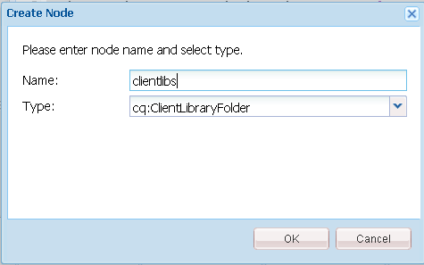
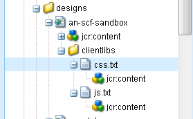
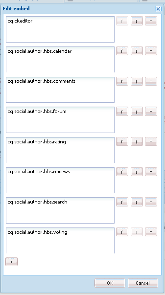
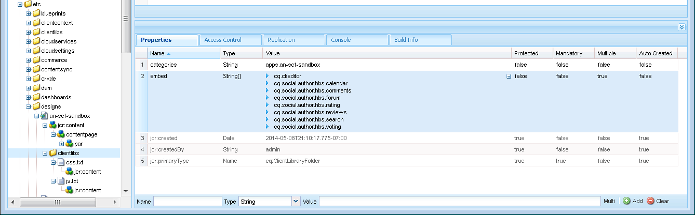
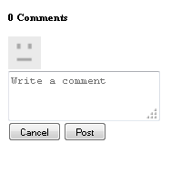
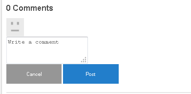
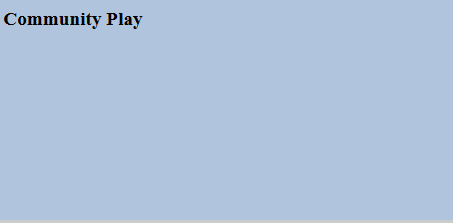

# Clientlibs hinzufügen {#add-clientlibs}

## Hinzufügen eines Client-Bibliotheksordners (clientlibs) {#add-a-clientlibraryfolder-clientlibs}

Erstellen Sie einen ClientLibraryFolder mit dem Namen `clientlibs`, der die JavaScript (JS)- und Cascading Stylesheets (CSS) enthält, die zum Rendern der Seiten Ihrer Site verwendet werden.

Der dieser Client-Bibliothek übergebene `categories`-Eigenschaftswert ist die Kennung, die verwendet wird, um diese Client-Bibliothek direkt von einer Inhaltsseite einzuschließen oder sie in andere Client-Bibliotheken einzubetten.

1. Mit **CRXDE Lite** erweitern Sie `/etc/designs`

1. Klicken Sie mit der rechten Maustaste auf `an-scf-sandbox` und wählen Sie `Create Node`

   * Name : `clientlibs`
   * Typ : `cq:ClientLibraryFolder`

1. Klicken Sie auf **OK**



Geben Sie auf **Registerkarte** Eigenschaften“ für den neuen `clientlibs` die Eigenschaft **Kategorien** ein:

* Name : **categories**
* Typ : **Zeichenfolge**
* Wert : **apps.an-scf-sandbox**
* Klicken Sie auf **Hinzufügen**
* Klicken Sie **Alle speichern**

Hinweis: Dem Kategoriewert wird „apps.“ vorangestellt. Dies ist eine Konvention, mit der die „besitzende Anwendung“ als im Ordner &quot;/apps“ und nicht in &quot;/libs“ identifiziert wird. WICHTIG: Fügen Sie Platzhalterdateien `js.tx` und **`css.txt`**. (Es ist offiziell keine cq:ClientLibraryFolder ohne sie.)

1. Rechtsklick auf **`/etc/designs/an-scf-sandbox/clientlibs`**
1. Wählen Sie **Datei erstellen…**
1. Enter **name:** `css.txt`
1. Wählen Sie **Datei erstellen…**
1. Enter **name:** `js.txt`
1. Klicken Sie **Alle speichern**



Die erste Zeile von css.txt und js.txt gibt den Basisspeicherort an, von dem aus die folgenden Dateilisten zu finden sind.

Versuchen Sie, den Inhalt von css.txt auf Folgendes festzulegen

```
#base=.
 style.css
```

Erstellen Sie dann unter „clientlibs“ eine Datei mit dem Namen „style.css“ und legen Sie den Inhalt auf fest.

`body {`

`background-color: #b0c4de;`

`}`

### SCF-Clientlibs einbetten {#embed-scf-clientlibs}

Geben **auf der** „Eigenschaften“ für den `clientlibs` die String-Eigenschaft mit mehreren Werten ein **embed**. Dadurch werden die erforderlichen [Client-seitigen Bibliotheken (clientlibs) für SCF-Komponenten &#x200B;](/help/communities/client-customize.md#clientlibs-for-scf). In diesem Tutorial werden viele der Client-Bibliotheken hinzugefügt, die für die Communities-Komponenten erforderlich sind.

Dies kann der gewünschte Ansatz für eine Produktions-Site sein, muss aber nicht, da es Überlegungen zur Benutzerfreundlichkeit im Verhältnis zur Größe/Geschwindigkeit der heruntergeladenen Clientlibs für jede Seite gibt.

Wenn Sie nur eine Funktion auf einer Seite verwenden, können Sie die vollständige Clientlib dieser Funktion direkt auf der Seite einfügen, z. B.

`% ui:includeClientLib categories=cq.social.hbs.forum" %`

In diesem Fall, einschließlich aller , werden die einfacheren SCF-Client-Bibliotheken, bei denen es sich um die Autoren-Client-Bibliotheken handelt, bevorzugt:

* Name : **`embed`**
* Typ : **`String`**
* **`Multi`** klicken
* Wert: **`cq.social.scf`**

  * Es wird ein Dialogfeld angezeigt,
    Klicken Sie nach jedem Eintrag auf **`+`** , um die folgenden Clientlib-Kategorien hinzuzufügen:

    * **`cq.ckeditor`**
    * **`cq.social.author.hbs.comments`**
    * **`cq.social.author.hbs.forum`**
    * **`cq.social.author.hbs.rating`**
    * **`cq.social.author.hbs.reviews`**
    * **`cq.social.author.hbs.voting`**
    * Klicken Sie auf **OK**

* Klicken Sie **Alle speichern**



So sollten `/etc/designs/an-scf-sandbox/clientlibs` jetzt im Repository angezeigt werden:



### Clientlibs in PlayPage-Vorlage einschließen {#include-clientlibs-in-playpage-template}

Ohne Einbeziehung der `apps.an-scf-sandbox` ClientLibraryFolder -Kategorie auf der Seite sind die SCF-Komponenten nicht funktionsfähig und auch nicht für die Formatierung geeignet, da die erforderlichen JavaScript- und CSS-Stile nicht verfügbar sind.

Ohne Client-Bibliotheken zum Beispiel erscheint die Komponente „SCF-Kommentare“ unformatiert:



Sobald apps.js-scf-sandbox-clientlibs eingeschlossen ist, erscheint die Komponente SCF-Kommentare mit dem Stil :



Die Include-Anweisung gehört in den `head` des `html`. Die **`foundation head.jsp`** enthält ein Skript, das überlagert werden kann: **`headlibs.jsp`**.

**Kopieren Sie „headlibs.jsp“ und schließen Sie clientlibs:** ein

1. Wählen Sie mit **&#x200B;**&#x200B;CRXDE Lite **`/libs/foundation/components/page/headlibs.jsp`**

1. Klicken Sie mit der rechten Maustaste und wählen **Kopieren** (oder wählen Sie Kopieren in der Symbolleiste)
1. Klicken Sie auf **`/apps/an-scf-sandbox/components/playpage`**
1. Klicken Sie mit der rechten Maustaste und wählen **Einfügen** (oder wählen Sie Einfügen aus der Symbolleiste)
1. Doppelklicken Sie auf **`headlibs.jsp`** , um es zu öffnen
1. Hängen Sie die folgende Zeile an das Ende der Datei an
   **`<ui:includeClientLib categories="apps.an-scf-sandbox"/>`**

1. Klicken Sie **Alle speichern**

```xml
<%@ page session="false" %><%
%><%@include file="/libs/foundation/global.jsp" %><%
%><ui:includeClientLib categories="cq.foundation-main"/><%
%>
<cq:include script="/libs/cq/cloudserviceconfigs/components/servicelibs/servicelibs.jsp"/>
<% currentDesign.writeCssIncludes(pageContext); %>
<ui:includeClientLib categories="apps.an-scf-sandbox"/>
```

Laden Sie Ihre Website im Browser und prüfen Sie, ob der Hintergrund kein Blautöne aufweist.

[https://localhost:4502/content/an-scf-sandbox/en/play.html](https://localhost:4502/content/an-scf-sandbox/en/play.html)



### Speichern Sie Ihre bisherige Arbeit {#saving-your-work-so-far}

An diesem Punkt gibt es eine minimalistische Sandbox. Es könnte sich lohnen, ihn als Paket zu speichern, sodass Sie Ihren Server während der Wiedergabe ausschalten können, wenn Ihr Repository beschädigt wird und Sie von vorne beginnen möchten. Benennen oder löschen Sie dann den Ordner „crx-quickstart/&quot;, schalten Sie Ihren Server ein, laden Sie dieses gespeicherte Paket hoch und installieren Sie es, und müssen Sie nicht die grundlegendsten Schritte wiederholen.

Dieses Paket ist im Tutorial [Erstellen einer Beispielseite](/help/communities/create-sample-page.md) für diejenigen enthalten, die nicht warten können, bis sie loslegen und mit der Wiedergabe beginnen.

So erstellen Sie ein Paket:

* Klicken Sie in CRXDE Lite auf das Symbol [Paket](https://localhost:4502/crx/packmgr/)
* Klicken Sie auf **Paket erstellen**

  * Paketname: an-scf-sandbox-minimal-pkg
  * Version: 0.1
  * Gruppe: `leave as default`
  * Klicken Sie auf **OK**

* Klicken Sie auf **Bearbeiten**.

  * Wählen Sie **Registerkarte** Filter“

    * Klicken Sie **Filter hinzufügen**
    * Stammverzeichnis: Navigieren Sie zu `/apps/an-scf-sandbox`
    * Klicken Sie auf **Fertig**.
    * Klicken Sie **Filter hinzufügen**
    * Stammverzeichnis: Navigieren Sie zu `/etc/designs/an-scf-sandbox`
    * Klicken Sie auf **Fertig**.
    * Klicken Sie **Filter hinzufügen**
    * Stammverzeichnis: Navigieren Sie zu `/content/an-scf-sandbox**`
    * Klicken Sie auf **Fertig**.

  * Klicken Sie auf **Speichern**.

* Klicken Sie auf **Erstellen**

Jetzt können Sie auf **Herunterladen** klicken, um die Sandbox auf der Festplatte zu speichern und **Paket hochzuladen** und auf **Mehr > Replizieren** klicken, um die Sandbox auf eine localhost-Veröffentlichungsinstanz zu pushen und den Bereich Ihrer Sandbox zu erweitern.
