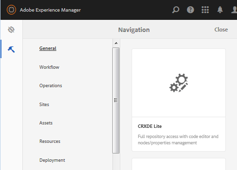

# Erstellen einer SCF-Sandbox  {#create-an-scf-sandbox}

Ab AEM 6.1 Communities besteht die einfachste Möglichkeit, eine Sandbox schnell zu erstellen, darin, eine Community-Site zu erstellen. Siehe [Erste Schritte mit AEM Communities](getting-started.md).

Ein weiteres nützliches Tool für Entwickler ist das [Community Components Guide](components-guide.md), das die Untersuchung und das schnelle Prototyping von Communities-Komponenten und -Funktionen ermöglicht.

Die Erstellung einer Website kann nützlich sein, um die Struktur einer AEM-Website zu verstehen, die Communities-Funktionen enthalten kann, und gleichzeitig einfache Seiten bereitzustellen, auf denen die Arbeit mit dem [Social Component Framework (SCF) untersucht werden kann](scf.md).

Dieses Tutorial richtet sich in erster Linie an Entwicklerinnen und Entwickler, die noch nicht mit AEM vertraut sind und Interesse an der Verwendung von SCF-Komponenten haben. Sie führt Sie durch die Erstellung einer SCF-Sandbox-Website, ähnlich dem Tutorial für [Erstellen einer voll funktionsfähigen Internet-Website](../../help/sites-developing/website.md) mit Fokus auf Site-Strukturen wie Navigation, Logo, Suche, Symbolleiste und Auflistung untergeordneter Seiten.

Die Entwicklung erfolgt auf einer Autoreninstanz, während das Experimentieren mit der Site am besten auf einer Veröffentlichungsinstanz durchgeführt wird.

Die Schritte in diesem Tutorial sind:

* [Einrichten der Website-Struktur](setup-website.md)
* [Ursprüngliche Sandbox-Anwendung](initial-app.md)
* [Anfänglicher Sandbox-Inhalt](initial-content.md)
* [Entwickeln eines Sandbox-Programms](develop-app.md)
* [Clientlibs hinzufügen](add-clientlibs.md)
* [Entwickeln von Sandbox-Inhalten](develop-content.md)

>[!CAUTION]
>
>In diesem Tutorial wird keine Community-Site mit der Funktion erstellt, die mithilfe der [Communities-Sites-Konsole](sites-console.md) erstellt wurde. In diesem Tutorial wird beispielsweise nicht beschrieben, wie Sie Anmeldung, Selbstregistrierung, [Social-Media-](social-login.md), Messaging, Profile usw. einrichten.
>
>Wenn eine einfache Community-Site bevorzugt wird, folgen Sie dem Tutorial [Erstellen einer Beispielseite](create-sample-page.md) .

## Voraussetzungen {#prerequisites}

In diesem Tutorial wird davon ausgegangen, dass Sie eine AEM-Autoreninstanz und eine AEM-Veröffentlichungsinstanz installiert haben, die über die [neueste Version](deploy-communities.md#latest-releases) von Communities verfügen.

Im Folgenden finden Sie einige hilfreiche Links für Entwicklerinnen und Entwickler, die neu in der AEM-Plattform sind:

* [Erste Schritte](../../help/sites-deploying/deploy.md#getting-started): für die Bereitstellung von AEM-Instanzen.

  * [Die Grundlagen](../../help/sites-developing/the-basics.md): für Entwickler von Websites und Funktionen.
  * [Erste Schritte für Autoren](../../help/sites-authoring/first-steps.md): für das Erstellen von Seiteninhalten.

## Verwenden der CRXDE Lite-Entwicklungsumgebung {#using-crxde-lite-development-environment}

AEM-Entwickler verbringen einen Großteil ihrer Zeit in der [CRXDE Lite](../../help/sites-developing/developing-with-crxde-lite.md)-Entwicklungsumgebung auf einer Autoreninstanz. CRXDE Lite bietet einen weniger eingeschränkten Zugriff auf das CRX-Repository. Die Tools der klassischen Benutzeroberfläche und die Konsolen der Touch-optimierten Benutzeroberfläche bieten strukturierteren Zugriff auf bestimmte Teile des CRX-Repositorys.

Nach der Anmeldung mit Administratorrechten gibt es verschiedene Möglichkeiten, auf CRXDE Lite zuzugreifen:

1. Wählen Sie in der globalen Navigation die Option Navigation **[!UICONTROL Tools > CRXDE Lite]**.

   

2. Scrollen Sie auf der [Startseite der klassischen Benutzeroberfläche](http://localhost:4502/welcome.html) nach unten und klicken Sie **rechten Bedienfeld auf** CRXDE Lite.

   

3. Navigieren Sie direkt zu `CRXDE Lite`: `<server>:<port>/crx/de`

   Auf einer lokalen Autoreninstanz: [http://localhost:4502/crx/de](http://localhost:4502/crx/de)

Um mit CRXDE Lite arbeiten zu können, müssen Sie sich mit Entwickler- oder Administratorrechten anmelden. Für die Standard-localhost-Instanz können Sie sich wie folgt anmelden:

* `username: admin`
* `password: admin`

Bei dieser Anmeldung tritt eine Zeitüberschreitung auf. Sie müssen sich daher regelmäßig über das Pulldown-Menü am rechten Ende der CRXDE Lite-Symbolleiste erneut anmelden.

Wenn Sie nicht angemeldet sind, können Sie nicht im JCR-Repository navigieren oder keine Bearbeitungs-/Speichervorgänge ausführen.

***Im Zweifelsfall bitte erneut anmelden!***

