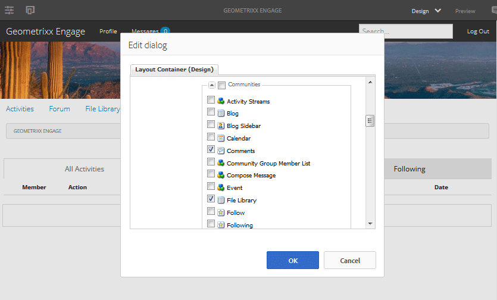
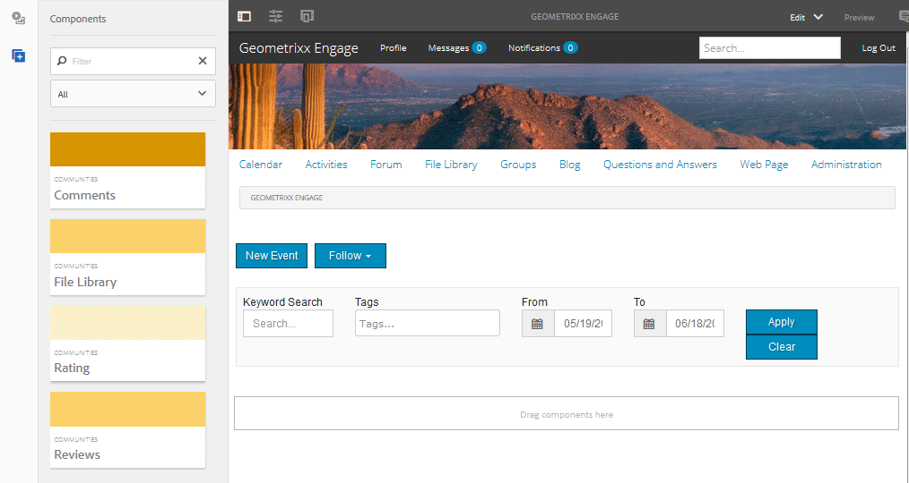

# Grundlagen zu Communities-Komponenten {#communities-components-basics}

## Überblick {#overview}

Im Abschnitt Authoring der Dokumentation wird beschrieben, wie Sie AEM-Sites im Authoring-Bearbeitungsmodus Communities-Funktionen hinzufügen und Komponentenkonfigurationen vornehmen.

Komponenten können mithilfe einer AEM-Instanz und des interaktiven [Community-Komponentenhandbuchs“ untersucht ](components-guide.md).

## Zugreifen auf Communities-Komponenten {#accessing-communities-components}

Wenn die zugrunde liegende Vorlage beim Erstellen von Seiteninhalten Änderungen am Design der Seite zulässt, können Sie Komponenten, die noch nicht im Komponenten-Browser verfügbar sind, als Teil des Site-Designs aktivieren.

Weitere Informationen finden Sie in der Liste unter [Verfügbare Communities-Komponenten](author-communities.md#available-communities-components).

>[!NOTE]
>
>Allgemeine Informationen zum Authoring finden Sie in der [Kurzanleitung zum Authoring von Seiten](../../help/sites-authoring/qg-page-authoring.md).
>
>Wenn Sie nicht mit AEM vertraut sind, lesen Sie die Dokumentation unter [Grundlegende Handhabung](../../help/sites-authoring/basic-handling.md).

### Wechseln in den Designmodus {#entering-design-mode}

Wenn eine **Communities**-Komponente nicht im Komponenten-Browser (Sidekick) gefunden wird, müssen Sie `Design Mode` eingeben, um andere Communities-Komponenten hinzuzufügen. [Erforderliche Client-seitige ](#required-clientlibs)) (clientlibs) müssen möglicherweise auch hinzugefügt werden.

Weitere Informationen finden Sie [Konfigurieren von Komponenten im Designmodus](../../help/sites-authoring/default-components-designmode.md).

Im Folgenden sehen Sie Bilder, wie Sie einige Communities-Komponenten auswählen und im Komponenten-Browser anzeigen:

Die ausgewählten Komponenten sind jetzt im Komponenten-Browser verfügbar:

## Erforderliche Clientlibs {#required-clientlibs}

[Client-seitige Bibliotheken](../../help/sites-developing/clientlibs.md) (Clientlibs) sind für das ordnungsgemäße Funktionieren (JavaScript) und Formatieren (CSS) einer Komponente erforderlich.

Wenn Sie einer Seite eine Communities-Komponente hinzufügen und das Ergebnis ein Fehler oder ein unerwartetes Erscheinungsbild ist, sollten Sie als Erstes versuchen, die erforderlichen Clientlibs für die Communities-Komponente hinzuzufügen. Weitere Informationen finden Sie unter [Clientlibs für Communities-Komponenten](clientlibs.md).

### Beispiel: Anfangs platzierte Reviews ohne Client-Bibliotheken… {#example-initially-placed-reviews-without-client-libraries}

### … Und mit Client-Bibliotheken {#and-with-client-libraries}

## Tagging {#tagging}

Viele Communities-Funktionen können so konfiguriert werden, dass Mitglieder Inhalte taggen können, die in der Veröffentlichungsumgebung eingegeben (veröffentlicht) wurden.

Wenn Tagging zulässig ist, kann die Konfiguration der Community-Site so festgelegt werden, dass die Namespaces beschränkt bleiben, die Mitgliedern in der Veröffentlichungsumgebung präsentiert werden. Siehe die [Community-Sites-Konsole](sites-console.md#tagging).

Funktionen, die das Tagging ermöglichen[ (](blog-feature.md)), [Kalender](calendar.md), [Dateibibliothek](file-library.md), [Forum](forum.md)

Funktionen, die Tags verwenden: [Suche](search.md), [Social Tag Cloud](tagcloud.md)

Für Authoring-Informationen:

* [Verwenden von Tags](../../help/sites-authoring/tags.md)

Für administrative Informationen:

* Erstellen von Tag-Namespaces (Taxonomie): [Verwalten von Tags](../../help/sites-administering/tags.md)
* Community-Site-Konfiguration: siehe [TAGGING](sites-console.md#tagging)
* [Tagging benutzergenerierter Inhalte](../../help/sites-authoring/tags.md)

Entwicklerinformationen:

* [AEM-Tagging-Framework](../../help/sites-developing/framework.md)
* [Tagging Grundlagen](tag.md)
