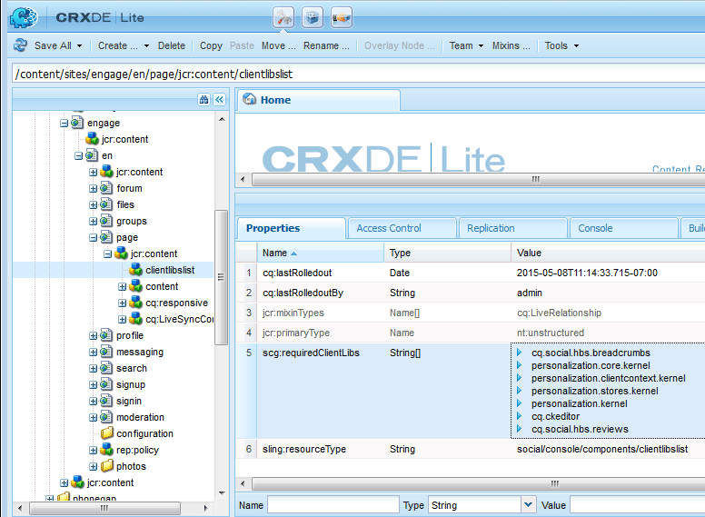

# Clientlibs für Communities-Komponenten {#clientlibs-for-communities-components}

## Einführung {#introduction}

In diesem Abschnitt der Dokumentation wird beschrieben, wie Sie einer Seite für Communities-Komponenten Client-seitige Bibliotheken (clientlibs) hinzufügen.

Grundlegende Informationen finden Sie in den folgenden Themen:

* [Verwendung Client-seitiger Bibliotheken](/help/sites-developing/clientlibs.md) mit Nutzungsdetails und Debugging-Tools
* [Clientlibs für SCF](/help/communities/client-customize.md#clientlibs), das nützliche Informationen beim Anpassen von SCF-Komponenten bereitstellt

## Warum Client-Bibliotheken erforderlich sind {#why-clientlibs-are-required}

Clientlibs sind für das ordnungsgemäße Funktionieren (JavaScript) und Formatieren (CSS) einer Komponente erforderlich.

Wenn für eine Funktion [Community-Funktion](/help/communities/functions.md) vorhanden ist, sind alle erforderlichen Komponenten und Konfigurationen, einschließlich der erforderlichen Clientlibs, auf der Community-Site vorhanden. Nur wenn Autoren zusätzliche Komponenten zur Verfügung stehen sollen, müssen zusätzliche Client-Bibliotheken hinzugefügt werden.

Wenn die erforderlichen clientlibs fehlen, kann [Hinzufügen einer Communitys-Komponente zu einer Seite](/help/communities/author-communities.md) zu JavaScript-Fehlern und einem unerwarteten Erscheinungsbild führen.

### Beispiel : platzierte Reviews ohne Clientlibs {#example-placed-reviews-without-clientlibs}

### Beispiel : Platzierte Rezensionen mit Clientlibs {#example-placed-reviews-with-clientlibs}

## Identifizieren erforderlicher Clientlibs {#identifying-required-clientlibs}

Die grundlegenden Funktionsinformationen für Entwickler identifizieren die erforderlichen Clientlibs.

Wenn Sie von einer AEM-Instanz aus zum [Community-Komponentenhandbuch“ navigieren](/help/communities/components-guide.md) erhalten Sie außerdem Zugriff auf eine Liste mit Client-Bibliothekskategorien, die für eine Komponente erforderlich sind.

Beispielsweise werden oben auf der Seite [Überprüfungen](https://localhost:4502/content/community-components/en/reviews.html) die erforderlichen Client-Bibliotheken aufgeführt.

* CQ.CKEditor
* CQ.social.hbs.reviews

## Hinzufügen erforderlicher Clientlibs {#adding-required-clientlibs}

Wenn Sie einer Seite eine Communities -Komponente hinzufügen möchten, müssen Sie die erforderlichen Clientlibs für die Komponente hinzufügen, falls diese noch nicht vorhanden ist.

Mit [CRXDE|Lite](#using-crxde-lite) können Sie eine vorhandene clientlibs-Liste für eine Community-Site-Seite ändern.

So fügen Sie mithilfe von [CRXDE Lite eine Client-Bibliothek für eine Community-Site ](/help/sites-developing/developing-with-crxde-lite.md):

* Navigieren Sie zu [https://&lt;server>:&lt;port>/crx/de](https://localhost:4502/crx/de).
* Suchen Sie den `clientlibslist` Knoten für die Seite, auf der Sie die Komponente hinzufügen möchten:

  * `/content/sites/sample/en/page/jcr:content/clientlibslist`

* Mit `clientlibslist` ausgewählten Knoten:

  * Suchen Sie die Zeichenfolge[] Eigenschaft `scg:requiredClientLibs`.
  * Wählen Sie die `Value` aus, damit Sie auf das Dialogfeld Zeichenfolgen-Array zugreifen können.

    * Scrollen Sie bei Bedarf nach unten.
    * Wählen Sie + aus, um eine neue Client-Bibliothek einzugeben.

      * Wiederholen Sie diesen Vorgang, um weitere Client-Bibliotheken hinzuzufügen.

      * Wählen Sie **OK** aus.

  * Klicken Sie auf **Alle speichern**.

>[!NOTE]
>
>Wenn die Site keine Community-Site ist, muss das Vorhandensein oder der Speicherort der für die Site verwendeten Client-Bibliotheken erkannt werden.

Wenn Sie das [Erste Schritte mit AEM Communities](/help/communities/getting-started.md) verwenden, `site-name` &quot;*&quot;*, würde die clientliblist wie folgt aussehen, wenn Sie die Reviews-Komponente hinzufügen:

