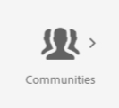

# Communities-Konsolen {#communities-consoles}

Die Konsolen von AEM Communities, die in der Autorenumgebung über das globale Navigationsfenster verfügbar sind, bieten Zugriff auf Verwaltungsaufgaben, z. B.:

* [Erstellen einer Community-Site](sites-console.md)
* Hinzufügen [Gruppen](groups.md) innerhalb der Site verschachtelt
* Verwalten [Community-Site-Vorlagen](sites.md)
* Verwalten [Community-Mitglieder](members.md)
* [Moderieren](moderate-ugc.md) benutzergenerierter Inhalte (UGC)
* Erstellen [benutzerdefinierte Abzeichen](badges.md)
* Konfigurieren des [Standardspeichers für benutzergenerierten Inhalt](srp-config.md)

Wenn [UGC-Speicher](working-with-srp.md) als gemeinsamer Speicher für Autoren- und Veröffentlichungsumgebungen konfiguriert ist, ](moderation.md) die [Moderationskonsole in Autoren- und Veröffentlichungsumgebungen auf einer einzelnen Instanz von UGC.

In der Autorenumgebung sind die `Communities` Konsolen nach der Anmeldung mit Administratorrechten über die Konsolen Navigation und Tools verfügbar.

>[!NOTE]
>
>In der Veröffentlichungsumgebung zeigt eine [Community-Site](sites-console.md) ein `Administration` Menüelement an, wenn das angemeldete Mitglied über die entsprechenden Berechtigungen verfügt.

## Globales Navigationsfenster {#global-navigation-panel}

Wählen Sie das Symbol `Adobe Experience Manager` oben links aus, um den globalen Navigationsbereich zu öffnen und auf zwei Symbole zuzugreifen:

* [Navigationskonsole](#navigation-console)
* [Tools-Konsole](tools.md)

## Navigationskonsole {#navigation-console}

Um auf die verschiedenen Communities-Konsolen zuzugreifen, wählen Sie in der globalen Navigation **Navigation, Communities** aus.

* [Sites](sites-console.md)

  Auf die Sites-Konsole kann in der Autorenumgebung zugegriffen werden, um Community-Sites und deren [ zu erstellen und zu ](groups.md).

* [Moderation](moderation.md)

  Die Moderationskonsole ist für die Massenmoderation von benutzergenerierten Inhalten und in der Autorenumgebung vorgesehen. Eine ähnliche Konsole für die Massenmoderation ist in der Veröffentlichungsumgebung für Community-Mitglieder verfügbar, denen die Rolle [Community-Moderator](users.md#publishenvironmentusersandgroups) für eine oder mehrere Community-Sites zugewiesen wurde.

* [Mitglieder, Gruppen](members.md)

  Die Konsolen Mitglieder und Gruppen dienen der Verwaltung von Community-Mitgliedern und Mitgliedergruppen, die in der Veröffentlichungsumgebung in der Autorenumgebung vorhanden sind.

* [Berichte](reports.md)

  In der Berichtskonsole können Berichte zu Zuweisungen, Seitenansichten und geposteten Inhalten (UGC) generiert werden, wenn eine Community-Site [Adobe Analytics aktiviert](sites-console.md#analytics). Die Konsole ist nur in der Autorenumgebung verfügbar.

## Tools-Konsole {#tools-console}

So greifen Sie über [ globale Navigation auf ](tools.md)Communities-Tools“ (früher die Administration-Console) zu: **[!UICONTROL Tools]** > **[!UICONTROL Communities]**
