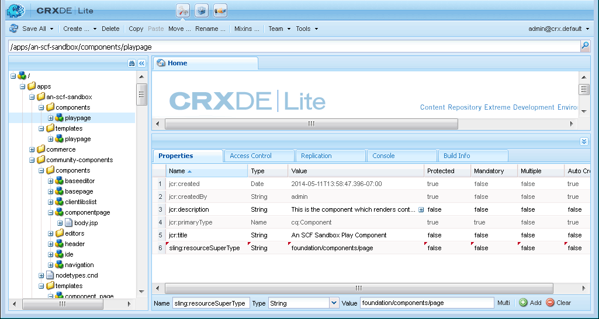
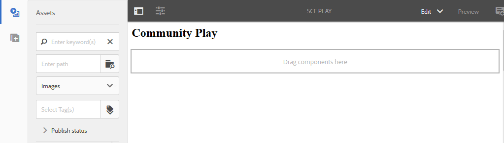

# Entwickeln eines Sandbox-Programms  {#develop-sandbox-application}

In diesem Abschnitt können Sie die Anwendung entwickeln, nachdem die Vorlage im Abschnitt [Anfangsanwendung](initial-app.md) und auf den Anfangsseiten im Abschnitt [Anfangsinhalt](initial-content.md) eingerichtet wurde. Dazu verwenden Sie Foundation-Skripte, die die Möglichkeit bieten, das Authoring mit Communities-Komponenten zu aktivieren. Am Ende dieses Abschnitts finden Sie eine voll funktionsfähige Website.

## Verwenden von Foundation-Seitenskripten {#using-foundation-page-scripts}

Das Standardskript, das erstellt wird, wenn die Komponente, die die Wiedergabeseitenvorlage rendert, hinzugefügt wurde, wird geändert, um die Datei head.jsp der Foundation-Seite und eine lokale body.jsp einzuschließen.

### Superressourcentyp {#super-resource-type}

Der erste Schritt besteht darin, dem `/apps/an-scf-sandbox/components/playpage` eine Eigenschaft des Ressourcen-Supertyps hinzuzufügen, damit er die Skripte und Eigenschaften des Supertyps erbt.

Verwenden von CRXDE Lite:

1. Wählen Sie `/apps/an-scf-sandbox/components/playpage` aus.
1. Geben Sie auf der Registerkarte Eigenschaften eine neue Eigenschaft mit den folgenden Werten ein:

   Name: `sling:resourceSuperType`

   Typ: `String`

   Wert: `foundation/components/page`

1. Klicken Sie auf die grüne Schaltfläche **[!UICONTROL +Hinzufügen]**.
1. Klicken Sie auf **[!UICONTROL Alle speichern]**.

   

### Kopf- und Textskripte {#head-and-body-scripts}

1. Navigieren Sie im **-Explorer-Fenster von** zu `/apps/an-scf-sandbox/components/playpage` und doppelklicken Sie auf die `playpage.jsp`, um sie im Bearbeitungsbereich zu öffnen.

   `/apps/an-scf-sandbox/components/playpage/playpage.jsp`

   ```xml
   <%--
   
     An SCF Sandbox Play Component component.
   
     This is the component which renders content for An SCF Sandbox page.
   
   --%><%
   %><%@include file="/libs/foundation/global.jsp"%><%
   %><%@page session="false" %><%
   %><%
    // TODO add your code here
   %>
   ```

1. Wenn Sie sich der offenen/geschlossenen Skript-Tags bewusst sind, ersetzen Sie &quot;// TODO …“ mit `includes` von Skripten für die Haupt- und Textteile von &lt;html>.

   Mit dem Supertyp `foundation/components/page` wird jedes Skript, das nicht in demselben Ordner definiert ist, in ein Skript `/apps/foundation/components/page` Ordner (falls vorhanden) oder in ein Skript `/libs/foundation/components/page` Ordner aufgelöst.

   `/apps/an-scf-sandbox/components/playpage/playpage.jsp`

   ```xml
   <%--
   
       An SCF Sandbox Play Component component: playpage.jsp
   
     This is the component which renders content for An SCF Sandbox page.
   
   --%><%
   %><%@include file="/libs/foundation/global.jsp"%><%
   %><%@page session="false" %>
   <html>
     <cq:include script="head.jsp"/>
     <cq:include script="body.jsp"/>
   </html>
   ```

1. Das Überlagern des Foundation-Skripts `head.jsp` ist nicht erforderlich, aber die Foundation-Skript-`body.jsp` ist leer.

   Überlagern Sie zum Einrichten für das Authoring `body.jsp` mit einem lokalen Skript und fügen Sie ein Absatzsystem (parsys) in den Hauptteil ein:

   1. Navigieren Sie zu `/apps/an-scf-sandbox/components`.
   1. Wählen Sie den `playpage`-Knoten aus.
   1. Klicken Sie mit der rechten Maustaste und wählen Sie `Create > Create File...`

      * Name: **body.jsp**

   1. Klicken Sie auf **[!UICONTROL Alle speichern]**.

   Öffnen Sie `/apps/an-scf-sandbox/components/playpage/body.jsp` und fügen Sie den folgenden Text ein:

   ```xml
   <%--
   
       An SCF Sandbox Play Component component: body.jsp
   
     This is the component which renders content for An SCF Sandbox page.
   
   --%><%
   %><%@include file="/libs/foundation/global.jsp"%><%
   %><%@page session="false" %>
   <body>
       <h2>Community Play</h2>
       <cq:include path="par" resourceType="foundation/components/parsys" />
   </body>
   ```

1. Klicken Sie auf **[!UICONTROL Alle speichern]**.

**Anzeigen der Seite in einem Browser im Bearbeitungsmodus:**

* Standard-Benutzeroberfläche: `http://localhost:4502/editor.html/content/an-scf-sandbox/en/play.html`

Sie sollten nicht nur die Überschrift **Community Play** sehen, sondern auch die Benutzeroberfläche zur Bearbeitung von Seiteninhalten.

Das seitliche Bedienfeld Assets/Komponente wird angezeigt, wenn sowohl das seitliche Bedienfeld geöffnet als auch das Fenster breit genug ist, um sowohl den Seiteninhalt als auch den Seiteninhalt anzuzeigen.



* Klassische Benutzeroberfläche: `http://localhost:4502/cf#/content/an-scf-sandbox/en/play.html`

Im Folgenden wird die Wiedergabeseite in der klassischen Benutzeroberfläche, einschließlich des Content Finders (cf), angezeigt:


## Communities-Komponenten {#communities-components}

Um Communities-Komponenten für das Authoring zu aktivieren, befolgen Sie zunächst die folgenden Anweisungen:

* [Zugreifen auf Communities-Komponenten](basics.md#accessing-communities-components)

Beginnen Sie für die Zwecke dieser Sandbox mit den folgenden **Communities**-Komponenten (aktivieren Sie dies, indem Sie das Kontrollkästchen aktivieren):

* Kommentare
* Forum
* Bewertung
* Bewertungen
* Bewertungszusammenfassung (Anzeige)
* Abstimmung

Wählen Sie außerdem **[!UICONTROL Allgemein]** Komponenten wie

* Bild
* Tabelle
* Text
* Titel (Foundation)

>[!NOTE]
>
>Die für das Seiten-Par aktivierten Komponenten werden im Repository als Wert der `components` -Eigenschaft des
>
>Knoten `/etc/designs/an-scf-sandbox/jcr:content/playpage/par`.

## Landingpage {#landing-page}

In einer mehrsprachigen Umgebung würde die Stammseite ein Skript enthalten, das die Anforderung vom Client analysiert, um die bevorzugte Sprache zu ermitteln.

In diesem Beispiel wird die Stammseite statisch so eingestellt, dass sie zur englischen Seite umgeleitet wird. Diese kann in Zukunft als Haupt-Landingpage mit einem Link zur Play-Seite entwickelt werden.

Ändern Sie die Browser-URL zur Stammseite: `http://localhost:4502/editor.html/content/an-scf-sandbox.html`

* Wählen Sie das Symbol Seiteninformationen aus
* Wählen Sie **[!UICONTROL Eigenschaften öffnen]**
* Auf der Registerkarte Erweitert

  * Navigieren Sie für den Eintrag Umleiten zu **[!UICONTROL Websites]** > **[!UICONTROL SCF Sandbox-Site]** > **[!UICONTROL SCF Sandbox]**
  * Klicken Sie auf **[!UICONTROL OK]**

* Klicken Sie auf **[!UICONTROL OK]**

Nachdem die Site veröffentlicht wurde, wird beim Navigieren zur Stammseite in einer Veröffentlichungsinstanz zur englischen Seite weitergeleitet.

Der letzte Schritt vor der Wiedergabe mit den Communities-SCF-Komponenten besteht darin, einen Client-Bibliotheksordner (clientlibs) hinzuzufügen …. [Clientlibs hinzufügen](add-clientlibs.md)
