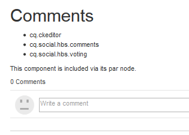
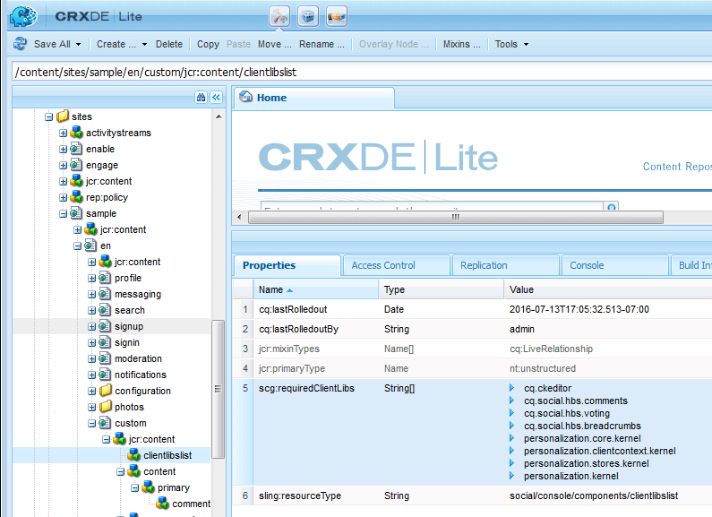

# Kommentar zur Beispielseite hinzufügen  {#add-comment-to-sample-page}

Nachdem die Komponenten für das benutzerdefinierte Kommentarsystem nun im Anwendungsverzeichnis (/apps) vorhanden sind, kann die erweiterte Komponente verwendet werden. Die Instanz des Kommentarsystems in einer betroffenen Website muss ihren resourceType als benutzerdefiniertes Kommentarsystem festlegen und alle erforderlichen Client-Bibliotheken einschließen.

## Erforderliche Clientlibs identifizieren {#identify-required-clientlibs}

Die Client-Bibliotheken, die für den Stil und die Funktionsweise der Standardkommentare erforderlich sind, sind auch für erweiterte Kommentare erforderlich.

Im [Community-Komponentenhandbuch](/help/communities/components-guide.md) werden die erforderlichen Client-Bibliotheken angegeben. Navigieren Sie zum Komponentenhandbuch und zeigen Sie die Komponente Kommentare an, z. B.:

[https://localhost:4502/content/community-components/en/comments.html](https://localhost:4502/content/community-components/en/comments.html)

Beachten Sie die drei Client-Bibliotheken, die für Kommentare erforderlich sind, damit sie ordnungsgemäß gerendert werden und funktionieren. Diese müssen dort eingefügt werden, wo auf die erweiterten Kommentare verwiesen wird, und in der [Client-Bibliothek der erweiterten Kommentare](/help/communities/extend-create-components.md#create-a-client-library-folder) ( `apps.custom.comments`).

### Hinzufügen benutzerdefinierter Kommentare zu einer Seite {#add-custom-comments-to-a-page}

Da pro Seite nur ein Kommentarsystem vorhanden sein kann, ist es einfacher, eine Beispielseite zu erstellen, wie im kurzen Tutorial [Erstellen einer Beispielseite](/help/communities/create-sample-page.md) beschrieben.

Wechseln Sie nach der Erstellung in den Designmodus und stellen Sie die benutzerdefinierte Komponentengruppe zur Verfügung, damit die `Alt Comments` Komponente zur Seite hinzugefügt werden kann.

Damit der Kommentar angezeigt wird und ordnungsgemäß funktioniert, müssen die Client-Bibliotheken für Kommentare zur clientlibs-Liste für die Seite hinzugefügt werden (siehe [Clientlibs für Communities-Komponenten](/help/communities/clientlibs.md)).

#### Kommentare zu Clientlibs auf Beispielseite {#comments-clientlibs-on-sample-page}

#### Autor: ALT-Kommentar auf Beispielseite {#author-alt-comment-on-sample-page}

#### Autor: Beispielseitenkommentarknoten {#author-sample-page-comments-node}

Sie können resourceType in CRXDE überprüfen, indem Sie die Eigenschaften des Kommentarknotens für die Beispielseite unter `/content/sites/sample/en/jcr:content/content/primary/comments` anzeigen.

#### Beispielseite veröffentlichen {#publish-sample-page}

Nachdem die benutzerdefinierte Komponente zur Seite hinzugefügt wurde, müssen Sie auch die Seite (erneut) [veröffentlichen](/help/communities/sites-console.md#publishing-the-site).

#### Veröffentlichen: ALT-Kommentar auf Beispielseite {#publish-alt-comment-on-sample-page}

Nach dem Veröffentlichen sowohl des benutzerdefinierten Programms als auch der Beispielseite ist es möglich, einen Kommentar einzugeben. Wenn Sie angemeldet sind, entweder mit einem [Demo-Benutzer](/help/communities/tutorials.md#demo-users) oder Administrator, ist es möglich, einen Kommentar zu posten.

Hier ist aaron.mcdonald@mailinator.com, das einen Kommentar postet:

Jetzt, da die erweiterte Komponente mit dem standardmäßigen Erscheinungsbild korrekt funktioniert, ist es an der Zeit, das Erscheinungsbild zu ändern.
