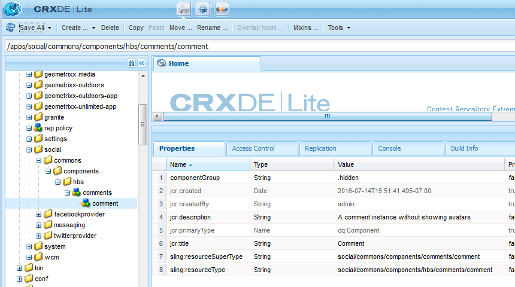

# Erstellen von Knoten {#create-nodes}

Überlagern Sie das Kommentarsystem mit einer benutzerdefinierten Version, indem Sie die minimal erforderliche Anzahl von Dateien aus `/libs` in `/apps` kopieren und in `/apps` ändern.

>[!CAUTION]
>
>Der Inhalt des Ordners /libs wird niemals bearbeitet, da durch eine Neuinstallation oder Aktualisierung der Ordner /libs gelöscht oder ersetzt werden kann, während der Inhalt des Ordners /apps unberührt bleibt.

Bei Verwendung von [CRXDE Lite](../../help/sites-developing/developing-with-crxde-lite.md) auf einer Autoreninstanz erstellen Sie zunächst einen Pfad im Ordner &quot;/apps“, der mit dem Pfad zu den überlagerten Komponenten im Ordner &quot;/libs“ identisch ist.

Der duplizierte Pfad lautet:

* `/libs/social/commons/components/hbs/comments/comment`

Einige Knoten im Pfad sind Ordner, andere Komponenten.

1. Navigieren Sie zu [http://localhost:4502/crx/de/index.jsp](http://localhost:4502/crx/de/index.jsp)
1. `/apps/social` erstellen (falls noch nicht vorhanden)
   * `/apps` auswählen
   * **[!UICONTROL Erstellen > Ordner]**
     * Namen eingeben: `social`
1. `social` auswählen
   * **[!UICONTROL Erstellen]** > **[!UICONTROL Ordner]**
     * Namen eingeben: `commons`
1. `commons` auswählen
   * **[!UICONTROL Erstellen > Ordner]**
     * Namen eingeben: `components`
1. `components` auswählen
   * **[!UICONTROL Erstellen > Ordner]**
     * Namen eingeben: `hbs`
1. `hbs` auswählen
   * **[!UICONTROL Erstellen]** > **[!UICONTROL Komponente erstellen]**
     * Bezeichnung eingeben: `comments`
     * Titel eingeben: `Comments`
     * Beschreibung eingeben: `List of comments without showing avatars`
     * Obertyp: `social/commons/components/comments`
     * Gruppe eingeben: `Communities`
     * Klicken Sie **[!UICONTROL Weiter]** bis **[!UICONTROL OK]**
1. `comments` auswählen

   * **[!UICONTROL Erstellen]** > **[!UICONTROL Komponente erstellen]**

     * Bezeichnung eingeben: `comment`
     * Titel eingeben: `Comment`
     * Beschreibung eingeben: `A comment instance without avatars`
     * Obertyp: `social/commons/components/comments/comment`
     * Gruppe eingeben: `.hidden`
     * Klicken Sie **[!UICONTROL Weiter]** bis **[!UICONTROL OK]**
   * Wählen Sie **[!UICONTROL Alle speichern]**
1. `comments.jsp` löschen
   * `/apps/social/commons/components/hbs/comments/comments.jsp` auswählen
   * Wählen Sie **[!UICONTROL Löschen]** aus
1. Löschen Sie „comment.jsp“.
   * `/apps/social/commons/components/hbs/comments/comment/comment.jsp` auswählen
   * Wählen Sie **[!UICONTROL Löschen]** aus
   * Wählen Sie **[!UICONTROL Alle speichern]**

>[!NOTE]
>
>Um die Vererbungskette beizubehalten, werden die `Super Type` (Eigenschaft `sling:resourceSuperType`) der Überlagerungskomponenten auf denselben Wert wie die `Super Type` der zu überlagernden Komponenten festgelegt. In diesem Fall:
>
>* `social/commons/components/comments`
>* `social/commons/components/comments/comment`

Der eigene `Type` der Überlagerung (Eigenschaft `sling:resourceType`) muss ein relativer Selbstverweis sein, damit nach Inhalten, die nicht in /apps gefunden werden, dann in /libs gesucht wird.
* Name: `sling:resourceType`
* Typ: `String`
* Wert: `social/commons/components/hbs/comments`

1. Grünen `[+] Add` auswählen
   * Name: `sling:resourceType`
   * Typ: `String`
   * Wert: `social/commons/components/hbs/comments/comment`
1. Grünen `[+] Add` auswählen
   * Wählen Sie **[!UICONTROL Alle speichern]**

