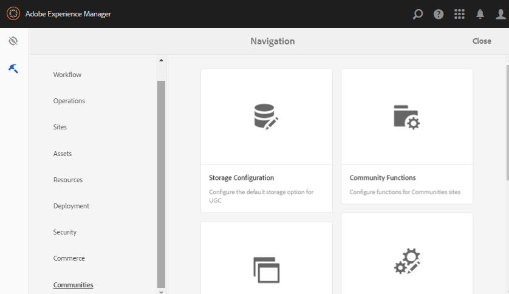

# Communities-Tools {#communities-tools}

Melden Sie sich bei Ihrer Autoreninstanz an, um auf die Tools-Konsole für Communities zuzugreifen:

* Über die globale Navigation: **[!UICONTROL Tools]** > **[!UICONTROL Communities]**.

  

* [Site-Vorlagen](sites.md) - Konsole für die Erstellung und Verwaltung von Site-Vorlagen

* [Gruppenvorlagen](tools-groups.md) - Konsole für die Erstellung und Verwaltung von Gruppenvorlagen.

* [Community-Funktionen](functions.md) - Konsole für die Erstellung und Verwaltung von Community-Funktionen.

* [Speicherkonfiguration](srp-config.md) - Konsole für die Konfiguration und Auswahl des [Standard-SRP](working-with-srp.md).

* [Komponentenleitfaden](components-guide.md) - Öffnet eine interaktive Website, auf der Sie ausprobieren können, wie die SCF-Komponenten funktionieren und wie sie konfiguriert oder angepasst werden können.

* [Badges](badges.md) - Konsole, über die benutzerdefinierte Badges zur Verwendung in (Scoring[&#x200B; und Badging-Regeln hinzugefügt werden können](implementing-scoring.md)
