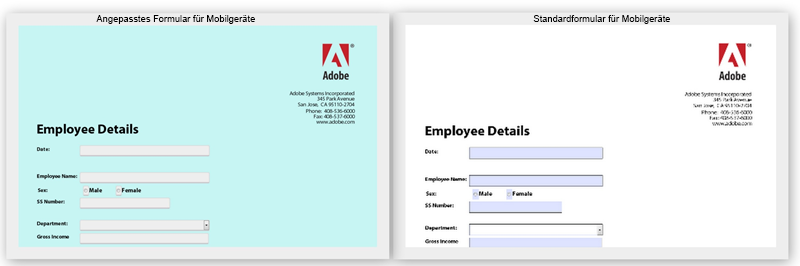

# Ändern von Standardstilen von HTML5-Formularen{#changing-default-styles-of-html-forms}

HTML5-Formulare werden mithilfe von HTML5-Funktionen gerendert. Der Stil des gerenderten Formulars wird mit CSS festgelegt. Das Standarderscheinungsbild von HTML5-Formularen ist der PDF-Darstellung ähnlich. Entwickelnde können benutzerdefinierte CSS verwenden, um das Standarderscheinungsbild von HTML5-Formularen zu ändern.

Dieser Artikel enthält Schritt-für-Schritt-Anleitungen, um den Stil eines HTML5-Formulars zu ändern, und der Artikel [Einführung in Stile](/help/forms/using/css-styles.md) enthält detaillierte Informationen zu den verschiedenen Gestaltungsaspekten von HTML5-Formularen. Stellen Sie sicher, dass Sie den Artikel „Einführung in Stile“ gelesen haben, bevor Sie die in diesem Artikel aufgeführten Schritte ausführen.

Die folgenden beiden Bilder zeigen den Unterschied zwischen Standard- und benutzerdefiniertem Stil.

## Gestalten Sie Ihre Formulare {#style-your-forms}

1. **Wählen Sie ein Profil aus, um benutzerdefinierte Stile hinzufügen**

   Rufen Sie die CRX DE-Schnittstelle unter der URL **https://&lt;Server>:&lt;Port>/crx/de** auf und erstellen Sie ein Profil oder wählen Sie ein vorhandenes Profil. Wie Sie ein Profil erstellen, erfahren Sie hier: [Erstellen eines Profils](/help/forms/using/custom-profile.md).

1. **Erstellen Sie ein CSS-Stylesheet zum Gestalten der HTML5-Formulare**

   Navigieren Sie zu dem Ordner, in dem Sie den Profil-Renderer erstellt haben, und erstellen Sie eine CSS-Stylesheet-Datei. Die zu befolgenden Schritte:

   1. Klicken Sie mit der rechten Maustaste auf den Ordner und wählen Sie **Erstellen**-> **Datei erstellen** im Menü aus.

   1. Geben Sie im Dateierstellungsdialog den Namen des Stylesheets ein. Achten Sie darauf, die Erweiterung „.css“ (z. B. stylesheet.css) zu verwenden.
   1. Öffnen Sie im Navigationsfeld die von Ihnen erstellte CSS-Datei.
   1. Definieren Sie die CSS-Klassen der Komponenten, die Sie gestalten wollen, und fügen Sie in diesen Klassen Stile hinzu.

   Welche CSS-Klassen für eine bestimmte Komponente in Ihrem HTML5-Formular zu erstellen sind, erfahren Sie in der [Einführung zu Stilen](/help/forms/using/css-styles.md).

1. **Schließen Sie das Stylesheet im Profil-Renderer ein**

   Öffnen Sie die Profil-Renderer-Seite (JSP-Datei) in CRX DE und schließen Sie die CSS-Datei auf der Seite direkt unter der XFA-Clientbibliothek ein. Führen Sie diese Schritte durch, um die css-Datei im Profil einzuschließen.

   1. Suchen Sie auf der Renderer-Seite nach der folgenden Zeile:

      &lt;cq:includeClientLib categories=„xfaforms.profile“ />

   1. Fügen Sie Folgendes unter der darüberstehenden Zeile ein, um das Stylesheet einzuschließen:

      &lt;link href=&quot;/path/to/stylesheet&quot; rel=&quot;stylesheet&quot; type=&quot;text/css&quot;/>

   1. Speichern Sie die Datei.
