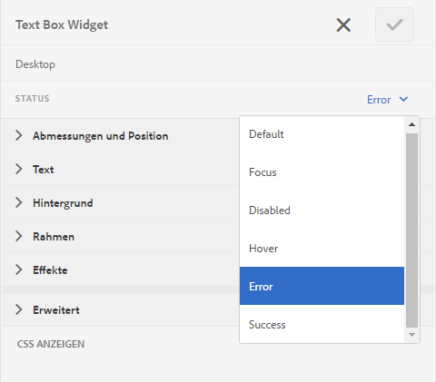

# Anpassen des Layouts und der Positionierung von Fehlermeldungen eines adaptiven Formulars{#customize-layout-and-positioning-of-error-messages-of-an-adaptive-form}

Sie können Layout und Positionierung der Fehlermeldungen eines adaptiven Formulars anpassen. Sie können die folgenden Anpassungen vornehmen:

* Anpassen von Position und Layout der Beschriftung eines Felds ohne Ändern der entsprechenden CSS-Eigenschaften
* Anpassen der Position von Inline-Fehlermeldungen
* Anpassen des Inhalts der dynamischen Hilfeanzeige
* Anpassen der Position der Feldkomponenten (Beschriftung, Widget, Kurzbeschreibung, Langbeschreibung und Komponenten der Hilfeanzeige) ohne Ändern der entsprechenden CSS-Eigenschaften

## Anpassen des Layouts von Feldern {#customize-layout-of-fields}

Sie können das Layout eines einzelnen Felds oder aller Felder anpassen, um die Position von Beschriftungen und Fehlermeldungen zu ändern.

Gehen Sie wie folgt vor, um ein benutzerdefiniertes Layout auf ein Feld anzuwenden:

### Anpassen des Layouts eines einzelnen Felds {#customize-layout-of-a-single-field}

1. Öffnen Sie das Formular im **Stilmodus**. Um das Formular im Stilmodus zu öffnen, wählen Sie in der Symbolleiste der Seite  > **Stil** aus.
1. Wählen Sie in der Seitenleiste unter **Formularobjekte** das Feld und dann die Schaltfläche „Bearbeiten“  aus.
1. Wählen Sie den Status des Felds, das Sie anpassen möchten, und geben Sie den Stil für diesen Status an.

   

### Anpassen des Layouts aller Felder eines Formulars {#customize-layout-of-all-the-fields-of-a-form}

Mit AEM Forms können Sie jetzt ein Design erstellen und auf Ihr Formular anwenden. Im Design-Editor können Sie zentral den Stil von Formularkomponenten angeben. Beim Erstellen eines Designs geben Sie Stile auf Komponentenebene an. Weitere Informationen zu Designs finden Sie unter [Designs in AEM Forms](../../forms/using/themes.md).

Indem Sie ein Design im Design-Editor erstellen, können Sie das Layout aller Felder im Formular anpassen. Nachdem Sie ein Design erstellt haben, führen Sie die folgenden Schritte aus, um es auf ein Formular anzuwenden:

1. Öffnen Sie das Formular im Bearbeitungsmodus.
1. Wählen Sie im Bearbeitungsmodus eine Komponente,  > **Container für ein adaptives Formular** und dann  aus.
1. Wählen Sie in der Seitenleiste unter „Adaptives Formulardesign“ das Design aus, das Sie im Design-Editor erstellt haben.

## Erstellen eines benutzerdefinierten Feld-Layouts {#create-a-custom-field-layout}

1. Öffnen Sie CRXDE Lite. Die Standard-URL lautet https://&#39;[server]:[port]&#39;/crx/de.
1. Kopieren Sie ein Feld-Layout vom Knoten „/libs/fd/af/layouts/field“ (z. B. „defaultFieldLayout“) in den Knoten „/apps“ (z. B. „/apps/af-field-layout“).
1. Benennen Sie den kopierten Knoten und die Datei „defaultFieldLayout.jsp“ um. Beispielsweise in „errorOnRight.jsp“.

1. Ändern Sie den Wert der Eigenschaften „qtip“ und &quot;:descriptionjcr)“ des kopierten Knotens. Ändern Sie z. B. den Wert der Eigenschaften in „Error On Right“

1. Um neue Stile und Verhaltensweisen hinzuzufügen, erstellen Sie eine Client-Bibliothek unter dem Knoten „/etc“.

   Erstellen Sie z. B. im Verzeichnis „/etc/af-field-layout-clientlib“ den Knoten „client-library“. Fügen Sie die Kategorieneigenschaft mit dem Wert „af.field.errorOnRight“ und die style.less-Datei mit folgendem Code hinzu:

   ```css
   .widgetErrorWrapper {
   
    height: 38px;
    margin: 5px;
   
    .guideFieldWidget{
    width: 60%;
    float: left; 
    }
   
    .guideFieldError{
    overflow:hidden;
    width:40%; 
    }
   
   }
   ```

1. Beziehen Sie zur Verbesserung des Erscheinungsbilds und der Verhaltensweise die in der Layout-Datei (errorOnRight.jsp) erstellte Clientbibliothek ein.
1. Öffnen Sie das Dialogfeld „Bearbeiten“ und wählen Sie die Registerkarte **Stile** aus. Wählen Sie im Dropdown-Feld **Feld-Layout konfigurieren** das neu erstellte Layout aus und klicken Sie auf **OK**.

Das ErrorOnRight.zip-Paket enthält Code, um Fehlermeldungen auf der rechten Seite der Felder anzuzeigen.

[Datei laden](assets/erroronright.zip)
