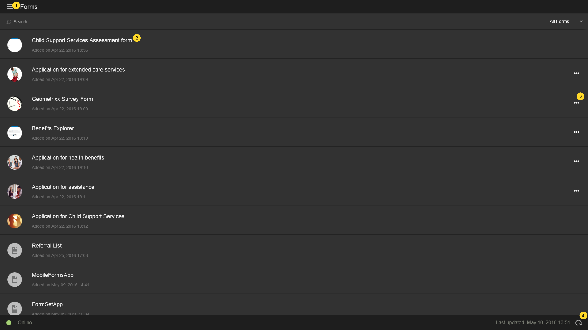

# Startbildschirm{#home-screen}

>[!NOTE]
>
>Die AEM Forms-App wird derzeit nicht mehr unterstützt. Bei Fragen oder Hilfe wenden Sie sich an [aemformsapp-android@adobe.com](mailto:aemformsapp-android@adobe.com).

Wenn Sie sich bei der AEM Forms-App anmelden, werden Sie zum Startbildschirm weitergeleitet.

## Standardmäßiger Startbildschirm {#default-home-screen}

Standardmäßig werden auf dem Startbildschirm alle Formulare einschließlich Startpunkten und Aufgaben (wenn der verbundene Server für den AEM Forms-Workflow aktiviert ist) zusammen mit den zugehörigen Miniaturansichten angezeigt. Sie können die Miniaturansichten auf dem AEM Forms-Server angeben.

In der folgenden Abbildung werden die wichtigsten Komponenten auf dem standardmäßigen Startbildschirm mit Anmerkungen erläutert.

<!--
Click to enlarge

-->

1. **Menüschaltfläche**: Wählen Sie die Schaltfläche **Menü**, um zu Aufgaben, Formularen, Posteingang und Einstellungen zu navigieren. Wenn Ihre AEM Forms-App mit einem AEM Forms JEE-Server verbunden ist, wird die Option „Aufgaben“ angezeigt. Die Option „Aufgaben“ speichert auch die Entwürfe, die aus Aufgaben in einem Prozess erstellt wurden. Bei AEM Forms-OSGi-Servern ist die Option „Aufgaben“ ausgeblendet. Der Postausgang speichert die gespeicherten Formulare und Entwürfe, bevor sie mit dem Server synchronisiert werden. Alle im Postausgang gespeicherten Formulare und Entwürfe werden auf den AEM Forms-Server hochgeladen, wenn die App [mit dem Server synchronisiert wird](../../forms/using/sync-app.md). Weitere Informationen zu den Einstellungen finden Sie unter [Aktualisieren allgemeiner Einstellungen](../../forms/using/update-general-settings.md).
1. **Aufgabe oder Formular**: Wählen Sie die aufgelistete Aufgabe oder das Formular, mit dem Sie arbeiten möchten.
1. **Horizontale Auslassungspunkte**: Gibt an, dass Aktionen für das Formular verfügbar sind. Durch Tippen auf die Auslassungspunkte werden die von der Autorin oder dem Autor bereitgestellten Aktionen und Beschreibungen angezeigt. Die Optionen **Entwurf löschen** und **Abgeschlossen** sind nur sichtbar, wenn Sie die Auslassungspunkte auswählen.
1. **Aktualisierungssymbol**: Wählen Sie das Aktualisierungssymbol, damit Sie Ihre App mit dem AEM Forms-Server synchronisieren können.

### Anpassen des Startbildschirms {#customizing-the-home-screen}

Sie können den Standardstartbildschirm der App entweder über die Registerkarte **[Allgemeine Einstellungen](../../forms/using/update-general-settings.md)** der App oder über die Registerkarte **Einstellungen** in HTML Workspace ändern.

Die Änderung an der Einstellung des Startbildschirms in der App wirkt sich auf den Startbildschirm der aktuell angemeldeten Person auf dem aktuellen Mobilgerät aus.

Die in HTML Workspace vorgenommene Änderung hingegen hat Auswirkungen für alle Benutzenden der AEM Forms-App, die beim AEM Forms-Server angemeldet sind.
