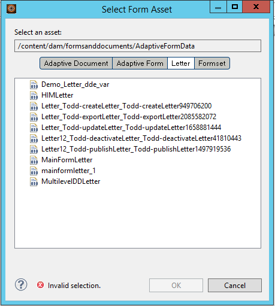
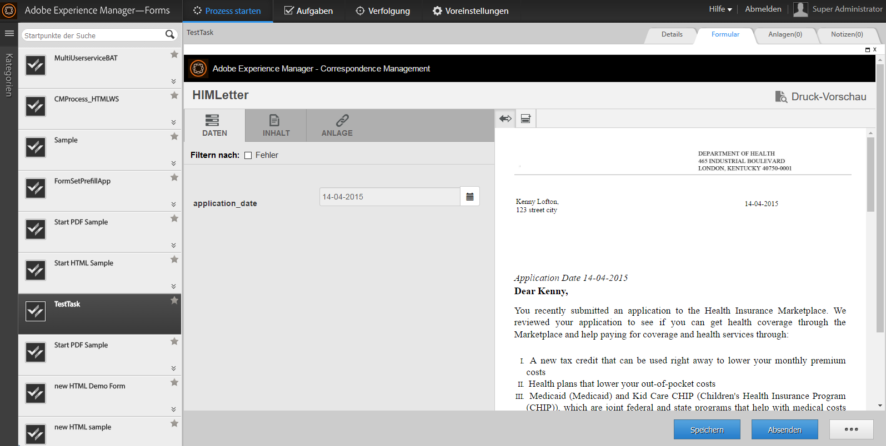

# Integrieren von Anwendungen von Drittanbietern in AEM Forms Workspace{#integrating-third-party-applications-in-aem-forms-workspace}

AEM Forms Workspace unterstützt die Verwaltung von Aufgabenzuweisungen und Abschlussaktivitäten für Formulare und Dokumente. Diese Formulare und Dokumente können XDP-Formulare, Flex®-Formulare oder Guides (veraltet) sein, die im Format XDP, PDF, HTML oder Flex gerendert wurden.

Diese Funktionen werden weiter verbessert. AEM Forms unterstützt jetzt die Zusammenarbeit mit Drittanbieteranwendungen, die Funktionen ähnlich wie die des AEM Forms-Arbeitsbereichs unterstützen. Ein gemeinsamer Teil dieser Funktion ist der Workflow der Zuweisung und nachfolgenden Genehmigung einer Aufgabe. AEM Forms bietet Unternehmensbenutzerinnen und -benutzern von AEM Forms ein einheitliches Erlebnis, sodass alle derartigen Aufgabenzuweisungen oder -genehmigungen für die unterstützten Anwendungen über den AEM Forms-Arbeitsbereich verarbeitet werden können.

Beispiel: die Integration von Correspondence Management in AEM Forms Workspace. Correspondence Management umfasst das Konzept „Brief“, der abgerufen werden kann und Aktionen zulässt.

## Correspondence Management-Elemente erstellen {#create-correspondence-management-assets}

Erstellen Sie zuerst eine Beispielvorlage für das Correspondence Management, die im AEM Forms-Arbeitsbereich wiedergegeben wird. Weitere Informationen finden Sie unter [Erstellen einer Briefvorlage](../../forms/using/create-letter.md).

Greifen Sie auf die Correspondence Management-Vorlage über die URL zu, um zu überprüfen, ob die Correspondence Management-Vorlage abgerufen werden kann. Die URL weist ein Muster auf, das `https://'[server]:[port]'/lc/content/cm/createcorrespondence.html?cmLetterId=encodedLetterId&cmUseTestData=1&cmPreview=0;` ähnlich sieht.

Dabei ist `encodedLetterId` die URL-kodierte Brief-ID. Geben Sie dieselbe Brief-ID an, wenn Sie den Wiedergabeprozess für Arbeitsbereichaufgaben in Workbench definieren.

## Erstellen einer Aufgabe zum Rendern und Senden eines Briefs in AEM Workspace {#create-a-task-to-render-and-submit-a-letter-in-aem-workspace}

Stellen Sie vor dem Ausführen dieser Schritte sicher, dass Sie Mitglied der folgenden Gruppen sind:

* cm-agent-users
* Workspace-Benutzende

Weitere Informationen finden Sie unter [Hinzufügen und Konfigurieren von Benutzenden](/help/forms/using/admin-help/adding-configuring-users.md).

Führen Sie die folgenden Schritte aus, um eine Aufgabe zum Rendern und Senden eines Briefs in AEM Workspace zu erstellen:

1. Starten Sie Workbench. Melden Sie sich bei Localhost als Admin an
1. Klicken Sie auf „Datei“ > „Neu“ > „Anwendung“. Geben Sie in das Feld „Anwendungsname“ `CMDemoSample` ein und klicken Sie dann auf „Fertig stellen“.
1. Wählen Sie `CMDemoSample/1.0` und klicken Sie mit der rechten Maustaste auf `NewProcess`. Geben Sie in das Namensfeld `CMRenderer` ein und klicken Sie dann auf „Fertig stellen“.
1. Ziehen Sie die Aktivitätenauswahl für den Startpunkt in den Arbeitsbereich und konfigurieren Sie sie:

   1. Wählen Sie unter „Präsentationsdaten“ die Option „CRX-Asset verwenden“ aus.

      

   1. Suchen Sie nach einem Asset. Im Dialogfeld „Formular-Asset auswählen“ werden auf der Registerkarte „Briefe“ alle Briefe auf dem Server aufgelistet.

      

   1. Wählen Sie den entsprechende Brief und klicken Sie auf **OK**.

1. Klicken Sie auf „Aktionsprofile verwalten“. Das Dialogfeld „Aktionsprofil verwalten“ wird angezeigt. Stellen Sie sicher, dass die Optionen „Prozess rendern“ und „Prozess senden“ ausgewählt sind.
1. Um den Brief mit einer XML-Datendatei zu öffnen, suchen Sie die entsprechende Datendatei und wählen Sie sie im Bereich „Datenprozess vorbereiten“ aus.
1. Klicken Sie auf OK.
1. Definieren Sie die Variablen für Startpunkt-Ausgabe und Aufgabenanhänge. Die definierten Variablen enthalten Daten zur Startpunktausgabe und zu Aufgabenanhänge.
1. (Optional) Um eine weitere Person als Benutzerin oder Benutzer im Workflow hinzuzufügen, ziehen Sie eine Aktivitätenauswahl, konfigurieren Sie sie und weisen Sie sie einer Person zu. Schreiben Sie einen benutzerdefinierten Wrapper (ein Beispiel wird unten angezeigt) oder laden Sie das DSC herunter und installieren Sie es (unten angezeigt), um Briefvorlagen, Startpunktausgabe und Aufgabenanhänge zu extrahieren.

   Ein benutzerdefinierter Beispiel-Wrapper wird nachfolgend aufgeführt:

   ```javascript
   public LetterInstanceInfo getLetterInstanceInfo(Document dataXML) throws Exception {
   try {
   if(dataXML == null)
   throw new Exception("dataXML is missing");
   
   CoreService coreService = getRemoteCoreService();
   if (coreService == null)
   throw new Exception("Unable to retrive service. Please verify connection details.");
   Map<String, Object> result = coreService.getLetterInstanceInfo(IOUtils.toString(dataXML.getInputStream(), "UTF-8"));
   LetterInstanceInfo letterInstanceInfo = new LetterInstanceInfo();
   
   List<Document> attachmentDocs = new ArrayList<Document>();
   List<byte[]> attachments = (List<byte[]>)result.get(CoreService.ATTACHMENT_KEY);
   if (attachments != null){
   for (byte[] attachment : attachments)
   { attachmentDocs.add(new Document(attachment)); }
   
   }
   letterInstanceInfo.setLetterAttachments(attachmentDocs);
   
   byte[] updateLayout = (byte[])result.get(CoreService.LAYOUT_TEMPLATE_KEY);
   if (updateLayout != null)
   { letterInstanceInfo.setLetterTemplate(new Document(updateLayout)); }
   
   else
   { throw new Exception("template bytes missing while getting Letter instance Info."); }
   
   return letterInstanceInfo;
   } catch (Exception e)
   { throw new Exception(e); }
   
   }
   ```

   [Datei abrufen](assets/dscsample.zip)
   DSC herunterladen: Ein Beispiel-DSC ist in der Datei „DSCSample.zip“ verfügbar, die oben angehängt ist. Laden Sie die Datei DSCSample.zip herunter und entpacken Sie sie. Bevor Sie den DSC-Service verwenden, müssen Sie ihn konfigurieren. Siehe [Konfigurieren des DSC-Dienstes](../../forms/using/add-action-button-in-create-correspondence-ui.md#p-configure-the-dsc-service-p).

   Wählen Sie im Dialogfeld „Aktivität definieren“ die entsprechende Aktivität wie getLetterInstanceInfo aus und klicken Sie auf **OK**.

1. Stellen Sie die Anwendung bereit. Wenn Sie dazu aufgefordert werden, checken Sie ein und speichern Sie die Assets.
1. Melden Sie sich beim AEM Forms-Arbeitsbereich unter https://&#39;[server]:[port]&#39;/lc/content/ws an.
1. Öffnen Sie die Aufgabe, die Sie in CMRenderer hinzugefügt haben. Der Correspondence Management-Brief wird angezeigt.

   

1. Geben Sie die erforderlichen Daten ein und senden Sie den Brief ab. Das Fenster schließt sich. In diesem Prozess wird die Aufgabe der Person zugewiesen, die im Workflow in Schritt 9 angegeben wurde.

   >[!NOTE]
   >
   >Die Schaltfläche „Senden“ wird erst aktiviert, nachdem alle erforderlichen Variablen im Brief ausgefüllt sind.
