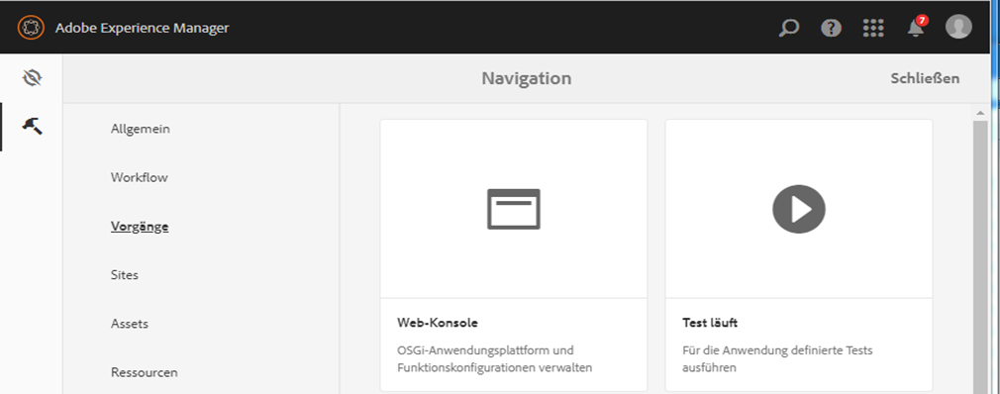
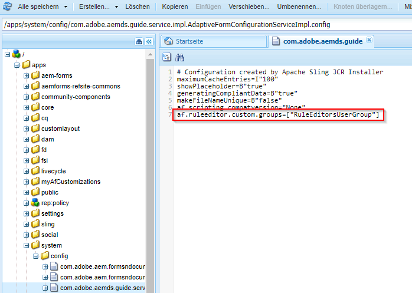
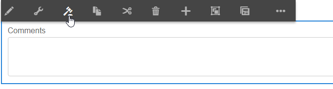

# Ausgewählten Benutzergruppen Zugriff auf den Regel-Editor gewähren{#grant-rule-editor-access-to-select-user-groups}

 Adobe empfiehlt, die modernen und erweiterbaren [Kernkomponenten](https://experienceleague.adobe.com/docs/experience-manager-core-components/using/adaptive-forms/introduction.html?lang=de) zur Datenerfassung zu verwenden, um [neue adaptive Formulare zu erstellen](/help/forms/using/create-an-adaptive-form-core-components.md) oder [adaptive Formulare zu AEM Sites-Seiten hinzuzufügen](/help/forms/using/create-or-add-an-adaptive-form-to-aem-sites-page.md). Diese Komponenten stellen einen bedeutenden Fortschritt bei der Erstellung adaptiver Formulare dar und sorgen für beeindruckende Anwendererlebnisse. In diesem Artikel wird ein älterer Ansatz zum Erstellen adaptiver Formulare mithilfe von Foundation-Komponenten beschrieben. 

## Übersicht {#overview}

Möglicherweise haben Sie mit unterschiedlichen Typen von Benutzenden mit unterschiedlichen Fähigkeiten zu tun, die mit adaptiven Formularen arbeiten. Während professionelle Benutzer möglicherweise über die nötigen Kenntnisse zum Arbeiten mit Skripten und komplexen Regeln verfügen, genügt es für Benutzer, die nur über Grundkenntnisse verfügen, mit dem Layout und einfachen Eigenschaften adaptiver Formulare zu arbeiten.

AEM Forms ermöglicht es Ihnen, den Zugriff auf den Regeleditor anhand der Rolle oder Funktion der Benutzenden einzuschränken. In den Einstellungen für den Konfigurationsdienst für adaptive Formulare können Sie festlegen, welche [Benutzergruppen](/help/sites-administering/security.md) den Regeleditor anzeigen und auf ihn zugreifen können.

## Angeben von Benutzergruppen für Zugriff auf Regeleditor {#specify-user-groups-that-can-access-rule-editor}

1. Melden Sie sich bei AEM Forms als Admin an.
1. Klicken Sie in der Autoreninstanz auf „Adobe Experience Manager“ > „Tools“  > „Vorgänge“ > „Web-Konsole“. Die Web-Konsole wird in einem neuen Fenster geöffnet.

   

1. Suchen Sie im Fenster „Web-Konsole“ nach **[!UICONTROL Konfiguration des Web-Kanals für adaptive Formulare und interaktive Kommunikation]** und klicken Sie darauf. Das Dialogfeld **[!UICONTROL Konfiguration des Web-Kanals für adaptive Formulare und interaktive Kommunikation]** wird angezeigt. Behalten Sie die Werte bei und klicken Sie auf **Speichern**.

   Die Datei „/apps/system/config/com.adobe.aemds.guide.service.impl.AdaptiveFormConfigurationServiceImpl.config“ im CRX-Repository wird erstellt.

1. Melden Sie sich als Administrator bei CRXDE an. Öffnen Sie die Datei „/apps/system/config/com.adobe.aemds.guide.service.impl.AdaptiveFormConfigurationServiceImpl.config“ zum Bearbeiten.
1. Geben Sie mithilfe folgender Eigenschaft den Namen einer Gruppe an, die auf den Regeleditor zugreifen kann (z. B. RuleEditorsUserGroup), und klicken Sie auf **Alle speichern**.

   `af.ruleeditor.custom.groups=["RuleEditorsUserGroup"]`

   Um den Zugriff für mehrere Gruppen zu ermöglichen, geben Sie eine Liste mit kommagetrennten Werten an:

   `af.ruleeditor.custom.groups=["RuleEditorsUserGroup", "PermittedUserGroup"]`

   

   Wenn jetzt eine Person, die nicht zur angegebenen Benutzergruppe (hier: RuleEditorsUserGroup) gehört, auf ein Feld tippt, ist das Symbol „Regel bearbeiten“ () für sie nicht in der Komponenten-Symbolleiste verfügbar:

   

   Komponentensymbolleiste für Benutzer mit Zugriff auf Regeleditor

   

   Komponentensymbolleiste für Benutzer ohne Zugriff auf Regeleditor:

   Anweisungen zum Hinzufügen von Benutzern zu Gruppen finden Sie unter [Benutzerverwaltung und Sicherheit](/help/sites-administering/security.md).
