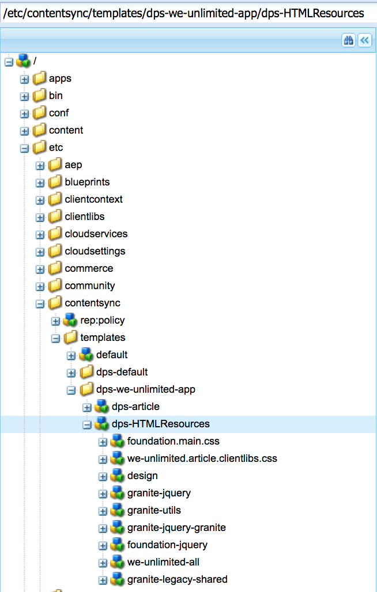

# Erstellen der Exportkonfiguration für freigegebene Ressourcen{#creating-shared-resources-export-configuration}

{{ue-over-mobile}}

>[!CAUTION]
>
>**Voraussetzung**:
>
>Bevor Sie mehr über das Erstellen und Ändern freigegebener Ressourcen erfahren, lesen Sie [Inhaltssynchronisierung](/help/mobile/mobile-ondemand-contentsync.md) um die grundlegenden Konzepte zu verstehen.

Adobe Experience Manager (AEM) Mobile-Benutzer verwenden Content Sync , um Live-Inhalte in statische Inhalte zur Verwendung in Mobile Apps zu exportieren. Dieser Export erfolgt, wenn Inhalte von AEM Mobile in Mobile On-Demand Services hochgeladen werden.

Die Eigenschaft ***dps-exportTemplate*** die in der obigen Tabelle erwähnt wird, definiert den Pfad zu den Exportkonfigurationen der App. Legen Sie diese Eigenschaft fest, um freigegebene Ressourcen zu erstellen und zu ändern.

Die folgenden Ressourcen beschreiben den Export freigegebener Ressourcen aus AEM zum Hochladen in AEM Mobile.

Freigegebene HTML-Ressourcen ermöglichen es Artikeln, HTML-Ressourcen freizugeben, die sonst für alle Artikel dupliziert würden, und können Symbole, Schriftarten, JavaScript und CSS enthalten.

Die Konfiguration der Inhaltssynchronisierung unter **&lt;dps-exportTemplate>/dps-HTMLResources>** sollte so konfiguriert werden, dass der gesamte Inhalt eines Artikels, der für das statische Rendern von Eigenschaften auf dem Gerät erforderlich ist, exportiert wird.

>[!CAUTION]
>
>Sie können die folgenden Schritte ausführen, um Beispiele für freigegebene Ressourcen anzuzeigen, sofern Sie über Folgendes verfügen:
>
>* Beispielinhalt installiert
>* AEM-Instanz wird ausgeführt
>* Kein konfigurierter benutzerdefinierter Kontext oder ein anderer Port
>

Gehen Sie wie folgt vor, um eine Beispiel-freigegebene Ressource anzuzeigen:

1. Öffnen Sie CRXDE Lite auf Ihrem AEM-Server.
1. Navigieren Sie zu diesem Pfad *[/etc/contentsync/templates/dps-we-unlimited-app/dps-HTMLResources](http://localhost:4502/crx/de/index.jsp#/etc/contentsync/templates/dps-we-unlimited-app/dps-HTMLResources)*, um die Beispiele für freigegebene Ressourcen anzuzeigen.

   Sie können alle Eigenschaften anzeigen, die zum Erstellen Ihrer freigegebenen Ressourcen erforderlich sind, wie in der folgenden Abbildung dargestellt:

   

>[!NOTE]
>
>Freigegebene Ressourcen sollten in AEM Mobile On-demand Services hochgeladen oder exportiert werden, wenn sich eine der freigegebenen Ressourcen ändert.
