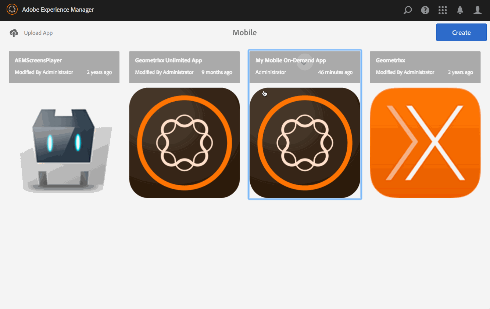

# Veröffentlichen von Inhalt aufheben der Veröffentlichung{#publish-unpublish-content}

{{ue-over-mobile}}

Sobald Sie mit Content-Management-Aktionen für Artikel, Banner und Sammlungen vertraut sind, können Sie Ihre Inhalte veröffentlichen. Außerdem können Sie die Veröffentlichung Ihres Inhalts aufheben.

>[!NOTE]
>
>Weitere Informationen über Entwurfsüberlegungen für AEM Mobile-Apps finden Sie unter [Entwurfsüberlegungen für AEM Mobile-Apps](https://helpx.adobe.com/digital-publishing-solution/help/aem-mobile-end-of-life-faq.html) in der Online-Hilfe.

## Veröffentlichen/Rückgängigmachen der Veröffentlichung von Inhalten {#publishing-unpublishing-the-content}

Dies unterscheidet sich von einer &quot;AEM-Veröffentlichung“. Inhalte werden nicht an eine AEM-Veröffentlichungs-Server-Instanz gepusht, um sie öffentlich sichtbar zu machen. Hier teilen Sie Mobile On-Demand mit, dass der ausgewählte Inhalt in der Live Mobile On-Demand-App veröffentlicht werden soll.

>[!NOTE]
>
>Inhalte müssen erst auf Mobile On-Demand hochgeladen werden, bevor sie veröffentlicht werden können.

Der allgemeine Workflow zum Veröffentlichen/Rückgängigmachen der Veröffentlichung eines Artikels:

1. Wählen Sie unter Mobile Ihre Mobile On-Demand-App aus dem Katalog aus.
1. Artikel auswählen.
1. Fügen Sie bei Bedarf weitere Artikel aus der Listenansicht hinzu.
1. Wählen Sie Veröffentlichen in der Aktionsleiste aus. Nach einigen Augenblicken werden Ihre Artikel nun öffentlich sein.
1. Gehen Sie wie oben beschrieben vor, um die Veröffentlichung von Artikeln rückgängig zu machen.

<!--
FAIL >>[!NOTE]
>
>Generally, you should preflight before publishing. See [Previewing with Preflight](/content/docs/en/aem/6-3/administer/mobile-apps/aem-mobile/previewing-with-preflight-on-demand-services.md) for more details.
-->

### Die nächsten Schritte {#the-next-steps}

Nachdem Sie sich mit dem Erstellen und Veröffentlichen von Inhalten vertraut gemacht haben, lesen Sie Folgendes:

* [Entwickeln von AEM-Inhalten für AEM Mobile On-demand Services](/help/mobile/aem-mobile-on-demand.md)
* [Verwalten von Inhalten zur Verwendung von AEM Mobile On-demand Services](/help/mobile/aem-mobile.md)

Wenn Sie weiterhin mehr über die Authoring-Themen erfahren möchten, finden Sie weitere Informationen unter [Authoring von AEM-Inhalten für AEM Mobile On-demand Services-Apps](/help/mobile/mobile-apps-ondemand.md).
