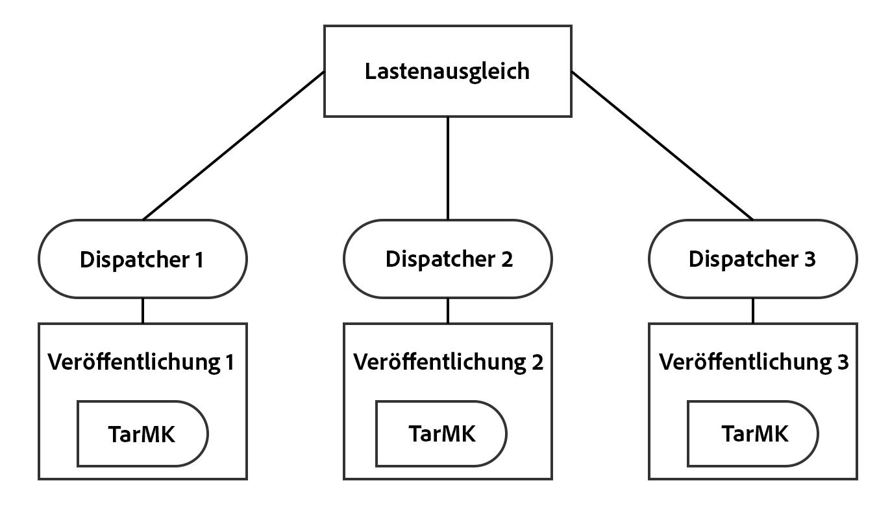
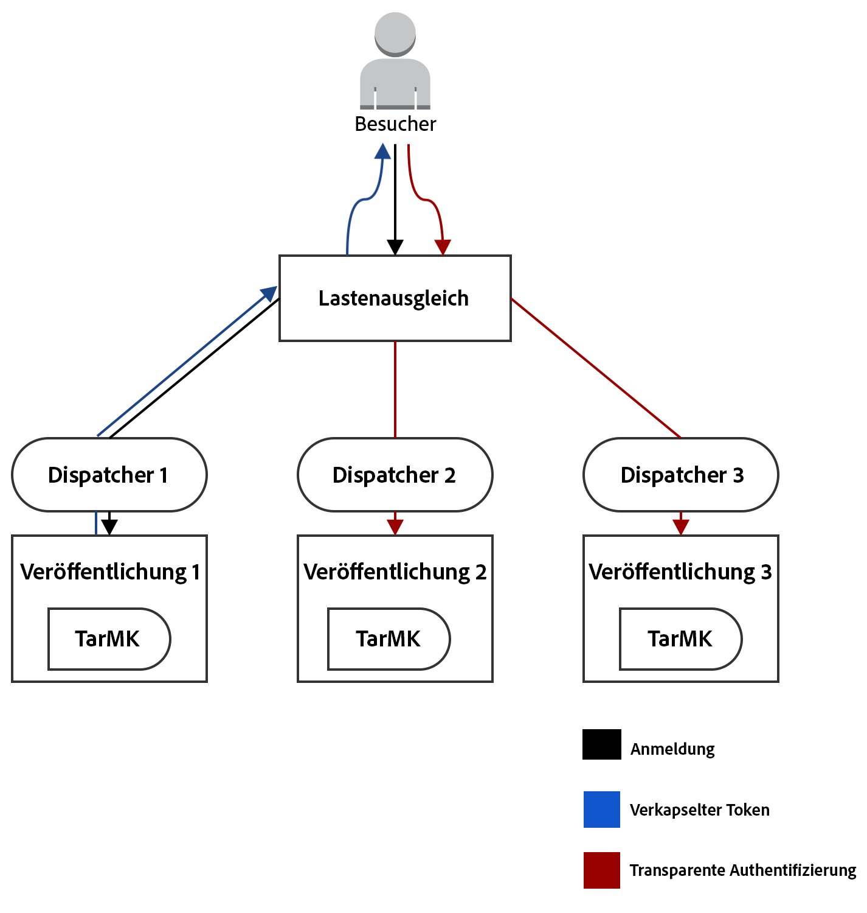

# Unterstützung von Encapsulated Tokens{#encapsulated-token-support}

## Einführung {#introduction}

Standardmäßig verwendet AEM den Token-Authentifizierungs-Handler, um Anfragen zu authentifizieren. Um Authentifizierungsanfragen zu erfüllen, benötigt der Token-Authentifizierungs-Handler jedoch für jede Anfrage Zugriff auf das Repository. Dies liegt daran, dass Cookies verwendet werden, um den Authentifizierungsstatus aufrechtzuerhalten. Logischerweise muss der Status im Repository beibehalten werden, um nachfolgende Anfragen zu validieren. Das bedeutet, dass der Authentifizierungsmechanismus zustandsabhängig ist.

Dies ist für die horizontale Skalierbarkeit besonders wichtig. Bei einem Setup mit mehreren Instanzen, wie etwa der unten dargestellten Veröffentlichungsfarm, kann die Lastverteilung nie optimal sein. Bei der zustandsabhängigen Authentifizierung ist der gespeicherte Authentifizierungsstatus nur auf der Instanz verfügbar, auf der der Benutzer zum ersten Mal authentifiziert wird.

Nehmen Sie das folgende Szenario als Beispiel:

Eine Person kann in der Veröffentlichungsinstanz 1 authentifiziert werden. Wenn jedoch eine nachfolgende Anfrage an die Veröffentlichungsinstanz 2 gesendet wird, ist auf dieser Instanz der beibehaltene Authentifizierungsstatus nicht verfügbar, da dieser Status im Repository der Veröffentlichungsinstanz 1 beibehalten wurde und die Veröffentlichungsinstanz 2 ihr eigenes Repository hat.

Die Lösung dafür besteht darin, dauerhafte Verbindungen auf der Ebene des Lastenausgleichs zu konfigurieren. Bei dauerhaften Verbindungen werden Benutzende immer zur selben Veröffentlichungsinstanz weitergeleitet. Daher ist ein wirklich optimaler Lastenausgleich nicht möglich.

Wenn eine Veröffentlichungsinstanz nicht mehr verfügbar ist, gehen die Sitzungen aller auf dieser Instanz authentifizierten Benutzenden verloren. Dies liegt daran, dass zum Überprüfen des Authentifizierungs-Cookies Repository-Zugriff erforderlich ist.

## „Stateless“-Authentifizierung mit dem Encapsulated Token {#stateless-authentication-with-the-encapsulated-token}

Die Lösung für die horizontale Skalierbarkeit besteht in der „Stateless“-Authentifizierung, bei der die neue Unterstützung von Encapsulated Tokens in AEM genutzt wird.

Das Encapsulated Token ist ein kryptografisches Element, das AEM die sichere Erstellung und Validierung von Authentifizierungsdaten offline ermöglicht, ohne dass ein Zugriff auf das Repository nötig ist. Auf diese Weise kann eine Authentifizierungsanfrage auf allen Veröffentlichungsinstanzen ohne Sticky-Verbindung durchgeführt werden. Darüber hinaus hat dieser Ansatz den Vorteil, dass die Authentifizierungsleistung verbessert wird, da nicht für jede Authentifizierungsanfrage auf das Repository zugegriffen werden muss.

Wie dies in einer geografisch verteilten Bereitstellung mit MongoMK-Autoren und TarMK-Veröffentlichungsinstanzen funktioniert, sehen Sie in der folgenden Grafik:

>[!NOTE]
>
>Das Encapsulated Token dient zur Authentifizierung. Dadurch wird sichergestellt, dass das Cookie ohne Zugriff auf das Repository validiert werden kann. Es ist jedoch weiterhin erforderlich, dass die Benutzenden in allen Instanzen vorhanden sind und dass die unter diesen Benutzenden gespeicherten Informationen für jede Instanz zugänglich sind.
>
>Wenn beispielsweise neue Benutzende auf der Veröffentlichungsinstanz 1 erstellt werden, werden sie aufgrund der Funktionsweise des Encapsulated Tokens erfolgreich auf der Veröffentlichungsinstanz 2 authentifiziert. Wenn die Benutzenden auf der zweiten Veröffentlichungsinstanz nicht vorhanden sind, ist die Anfrage dennoch nicht erfolgreich.
>

## Konfigurieren des Encapsulated Tokens {#configuring-the-encapsulated-token}

>[!NOTE]
>Alle Authentifizierungs-Handler, die Benutzer synchronisieren und auf Token-Authentifizierung (wie SAML und OAuth) angewiesen sind, funktionieren nur mit verkapselten Token, wenn:
>
>* fixierbare Sitzungen aktiviert sind oder
>
>* Benutzer bereits in AEM erstellt werden, wenn die Synchronisierung beginnt. Das bedeutet, dass gekapselte Token in Situationen, in denen die Handler während des Synchronisierungsprozesses Benutzer **erstellen**, nicht unterstützt werden.

Beim Konfigurieren des Encapsulated Tokens müssen einige Aspekte beachtet werden:

1. Aufgrund der Verschlüsselung müssen alle Instanzen denselben HMAC-Schlüssel aufweisen. Seit AEM 6.3 werden die Schlüsseldaten nicht mehr im Repository, sondern im Dateisystem selbst gespeichert. Daher besteht die beste Möglichkeit zum Replizieren der Schlüssel darin, sie vom Dateisystem der Quellinstanz zum Dateisystem der Zielinstanz(en) zu kopieren, auf die Sie die Schlüssel replizieren möchten. Weitere Informationen dazu finden Sie unter „Replizieren des HMAC-Schlüssels“.
1. Das Encapsulated Token muss aktiviert sein. Dies kann über die Web-Konsole erfolgen.

### Replizieren des HMAC-Schlüssels {#replicating-the-hmac-key}

Um den Schlüssel auf weitere Instanzen zu replizieren, führen Sie die folgenden Schritte durch:

1. Greifen Sie auf die AEM-Instanz zu, auf der sich die zu kopierenden Schlüsseldaten befinden. In der Regel handelt es sich dabei um eine Autoreninstanz.
1. Suchen Sie im lokalen Dateisystem das Paket `com.adobe.granite.crypto.file`. Es kann sich z. B. unter diesem Pfad befinden:

   * `<author-aem-install-dir>/crx-quickstart/launchpad/felix/bundle25`

   Die Datei `bundle.info` in jedem Ordner identifiziert den Paketnamen.

1. Navigieren Sie zum Ordner „data“. Beispiel:

   * `<author-aem-install-dir>/crx-quickstart/launchpad/felix/bundle25/data`

1. die HMAC- und Master-Dateien kopieren.
1. Navigieren Sie dann zur Zielinstanz, auf der Sie den HMAC-Schlüssel duplizieren möchten, und dann zum Ordner „data“. Beispiel:

   * `<publish-aem-install-dir>/crx-quickstart/launchpad/felix/bundle25/data`

1. Fügen Sie die beiden zuvor kopierten Dateien ein.
1. [Aktualisieren Sie das Crypto-Paket](/help/communities/deploy-communities.md#refresh-the-granite-crypto-bundle), wenn die Zielinstanz bereits ausgeführt wird.

1. Wiederholen Sie die vorherigen Schritte für alle Instanzen, auf denen Sie den Schlüssel replizieren möchten.

#### Aktivieren des Encapsulated Tokens {#enabling-the-encapsulated-token}

Wenn Sie den HMAC-Schlüssel repliziert haben, können Sie das Encapsulated Token über die Web-Konsole aktivieren:

1. Lassen Sie Ihren Browser auf `https://serveraddress:port/system/console/configMgr` verweisen.
1. Suchen Sie den Eintrag **Adobe Granite Token Authentication Handler** und klicken Sie darauf.
1. Aktivieren Sie im daraufhin angezeigten Fenster das Kontrollkästchen **Unterstützung von Encapsulated Tokens aktivieren**. Klicken Sie dann auf **Speichern**.
