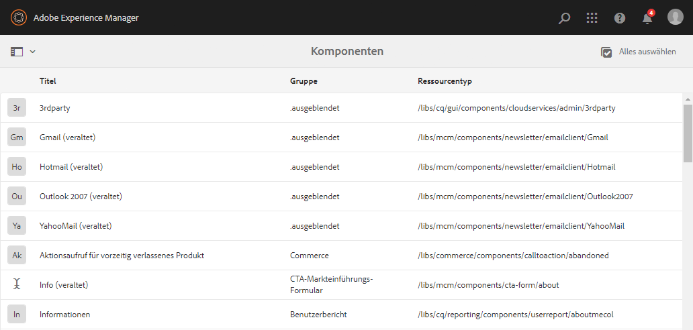
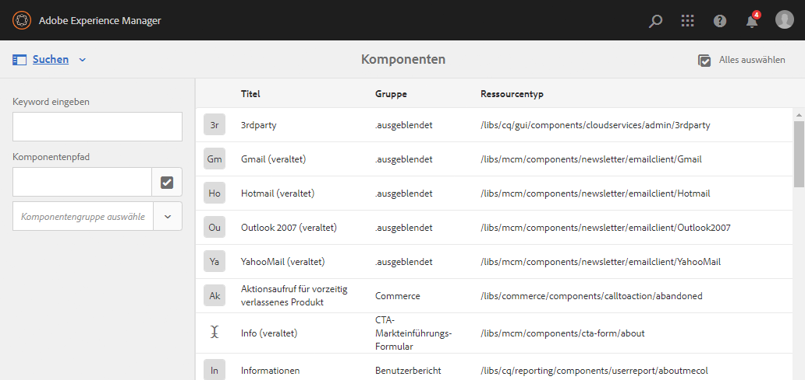
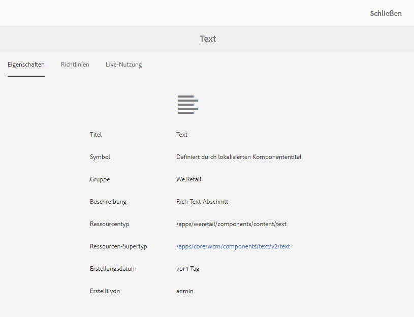
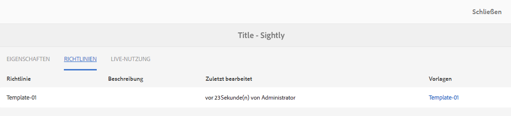
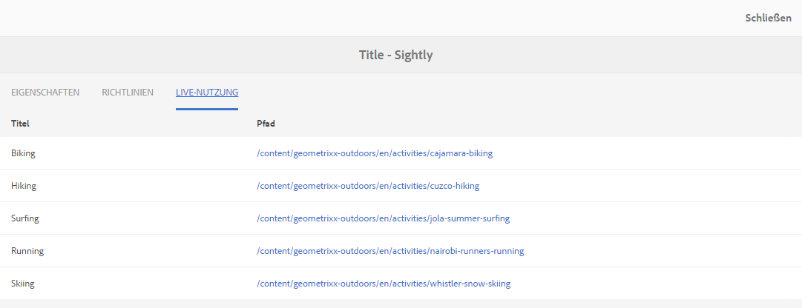
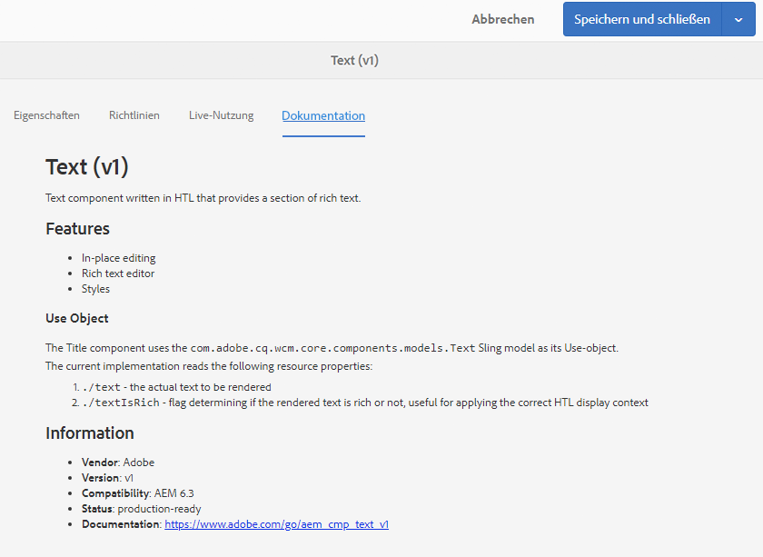

# Komponentenkonsole{#components-console}

Die Komponentenkonsole ermöglicht es Ihnen, alle Komponenten zu durchsuchen, die für Ihre Instanz definiert sind, und wichtige Informationen für jede Komponente anzuzeigen.

Auf sie kann über **Tools** > **Allgemein** > **Komponenten** zugegriffen werden. In der Konsole sind Karten- und Listenansicht verfügbar. Da es keine Baumstruktur für Komponenten gibt, ist die Spaltenansicht nicht verfügbar.

>[!NOTE]
>
>In der Komponentenkonsole werden alle im System vorhandenen Komponenten angezeigt. Im [Komponenten-Browser](/help/sites-authoring/author-environment-tools.md#components-browser) werden Komponenten angezeigt, die Autoren zur Verfügung stehen, und alle Komponentengruppen verborgen, die mit einem Punkt beginnen (`.`).

## Suchen {#searching}

Mit dem Symbol **Nur Inhalt** (oben links) können Sie den **Suchbereich** öffnen, um die Komponenten zu durchsuchen und/oder zu filtern:

### Komponentendetails {#component-details}

Um Details zu einer bestimmten Komponente anzuzeigen, klicken Sie auf die gewünschte Ressource. Drei Registerkarten bieten Folgendes:

* **Eigenschaften**

  

  In der Registerkarte „Eigenschaften“ haben Sie folgende Möglichkeiten:

  * Ansehen der allgemeinen Eigenschaften der Komponente
  * Anzeigen, wie das [Symbol oder die Abkürzung für die Komponente definiert wurde](/help/sites-developing/components-basics.md#component-icon-in-touch-ui).

    * Wenn Sie auf die Quelle des Symbols klicken, gelangen Sie zu dieser Komponente.

  * Zeigen Sie den **Ressourcentyp** und **Ressourcen-Supertyp** (sofern definiert) für die Komponente an.

    * Durch Klicken auf den Ressourcen-Supertyp gelangen Sie zu dieser Komponente.

  >[!NOTE]
  >
  >Da `/apps` zur Laufzeit nicht bearbeitet werden kann, ist die Komponentenkonsole schreibgeschützt.

* **Richtlinien**

  

* **Live-Nutzung**

  

  >[!CAUTION]
  >
  >Aufgrund der Art der Informationen, die für diese Ansicht erfasst werden, kann es eine Weile dauern, bis sie zusammengestellt/angezeigt wird.

* **Dokumentation**

  Etwaige von Entwickelnden [für eine Komponente bereitgestellte Dokumentationen](/help/sites-developing/developing-components.md#documenting-your-component) werden auf der Registerkarte **Dokumentation** angezeigt. Ist keine Dokumentation verfügbar, wird die Registerkarte **Dokumentation** nicht angezeigt.

  
