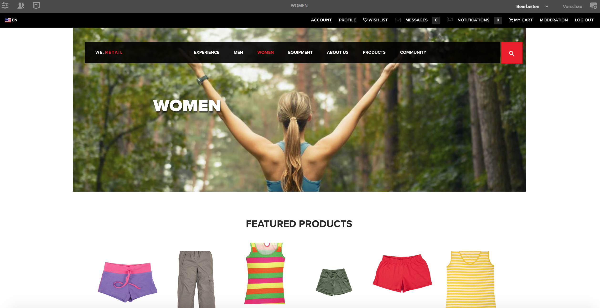

# Verfassen einer Seite für Mobilgeräte{#authoring-a-page-for-mobile-devices}

Wenn Sie eine Seite für Mobilgeräte bearbeiten, wird die Seite so angezeigt, dass das Mobilgerät emuliert wird. Beim Bearbeiten der Seite können Sie zwischen mehreren Emulatoren wechseln, um zu sehen, was die Endbenutzerinnen und -benutzer beim Zugriff auf die Seite sehen.

Geräte sind entsprechend ihrer Fähigkeit zur Wiedergabe einer Seite in die Kategorien „Feature“, „Smart“ und „Touch“ eingeteilt. Wenn die Endbenutzerinnen und -benutzer auf eine mobile Seite zugreifen, erkennt AEM das Gerät und übermittelt die Darstellung, die der Gerätegruppe entspricht.

>[!NOTE]
>
>Zur Erstellung einer Website für Mobilgeräte auf der Grundlage einer bestehenden Standard-Site erstellen Sie eine Live Copy der Standard-Site. (Siehe [Erstellen einer Live Copy für unterschiedliche Kanäle](/help/sites-administering/msm-livecopy.md).)
>
>AEM-Entwickler können neue Gerätegruppen erstellen. (Siehe [Erstellen von Gerätegruppen-Filtern](/help/sites-developing/groupfilters.md).)

Gehen Sie wie folgt vor, um eine Seite für Mobilgeräte zu erstellen:

1. Öffnen Sie ausgehend von der globalen Navigation die **Sites-Konsole**.
1. Öffnen Sie die Seite **We.Retail** > **Vereinigte Staaten** > **Englisch**.

1. Wechseln Sie in den **Vorschaumodus**.
1. Wechseln Sie durch Klicken auf das Gerätesymbol am oberen Seitenrand zum gewünschten Emulator.
1. Ziehen Sie Komponenten per Drag-and-Drop aus dem Komponenten-Browser auf die Seite.

Die Seite sieht ähnlich wie die folgende aus:

>[!NOTE]
>
>Die Emulatoren sind deaktiviert, wenn eine Seite in der Autoreninstanz von einem Mobilgerät aus aufgerufen wird.
