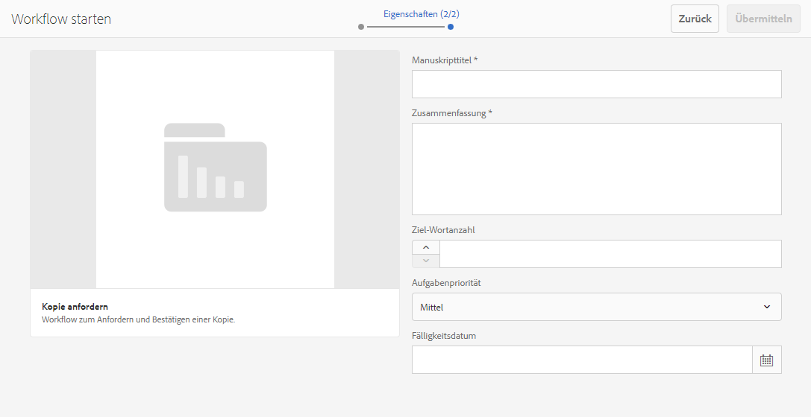
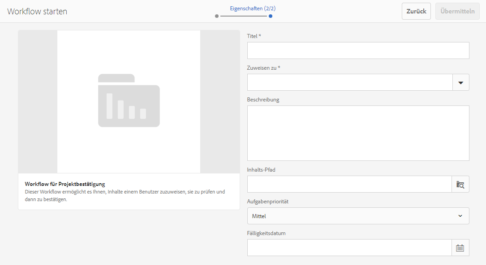
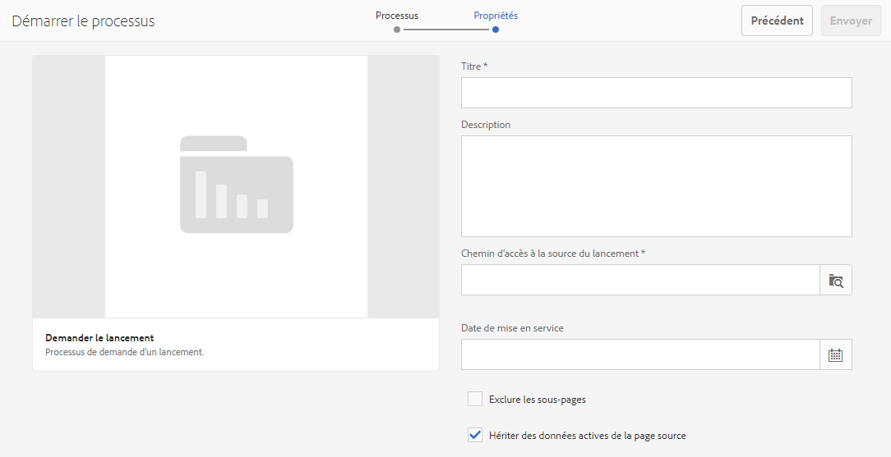
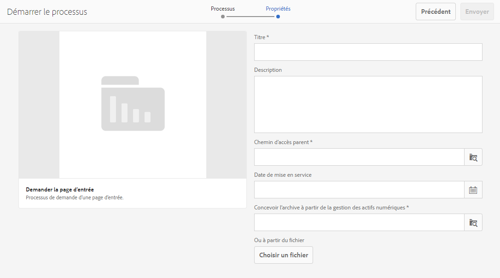
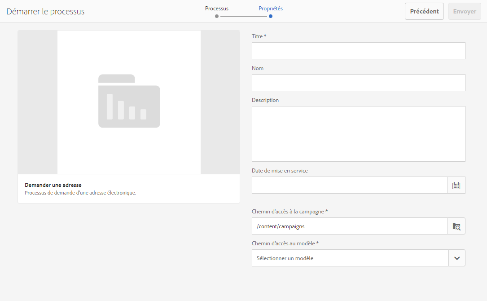

# Arbeiten mit Projekt-Workflows {#working-with-project-workflows}

Folgende vorkonfigurierte Projekt-Workflows sind im Lieferumfang enthalten:

* **Projektgenehmigungs-Workflow** – Mit diesem Workflow können Sie Inhalte einer Benutzerin bzw. einem Benutzer zuzuweisen, prüfen und bestätigen.
* **Launch anfragen** - Ein Workflow, der einen Launch anfordert.
* **Einstiegsseite anfragen** - Dieser Workflow fragt eine Landingpage an.
* **E-Mail anfragen** - Workflow zum Anfragen einer E-Mail.
* **Produkt-Fotoshooting und Produkt-Fotoshooting (Commerce)** - Ordnet Assets Produkten zu
* **DAM-Kopie erstellen und übersetzen und DAM-Sprachkopie erstellen** – Erstellt übersetzte Binärdateien, Metadaten und Tags für Assets und Ordner.

Je nachdem, welche Projektvorlage Sie auswählen, stehen Ihnen bestimmte Workflows zur Verfügung:

|   | **Einfaches Projekt** | **Medienprojekt** | **Projekt für Produkt-Fotoshooting** | **Übersetzungsprojekt** |
|---|:-:|:-:|:-:|:-:|
| Kopie anfragen |  | x |  |  |
| Produkt-Fotoshooting |  | x | x |  |
| Produkt-Fotoshooting (Commerce) |  |  | x |  |
| Projektgenehmigung | x |  |  |  |
| Launch anfragen | x |  |  |  |
| Landingpage anfragen | x |  |  |  |
| E-Mail anfragen | x |  |  |  |
| DAM Create Language Copy&ast; |  |  |  | x |
| DAM - Erstellen und Übersetzen von Sprachkopien&ast; |  |  |  | x |

>[!NOTE]
>
>&ast; Diese Workflows werden in Projekten nicht über die Kachel **Workflow** gestartet. Weitere Informationen finden Sie unter [Erstellen von Sprachkopien für Assets](/help/sites-administering/tc-manage.md).

Das Starten und Abschließen eines Workflows ist unabhängig vom gewählten Workflow immer gleich. Nur die Schritte ändern sich.

Sie starten einen Workflow direkt in Projekten (mit Ausnahme von „DAM-Kopie erstellen und übersetzen“ und „DAM-Sprachkopie erstellen“). Informationen zu ausstehenden Aufgaben in einem Projekt finden Sie in der Kachel **Aufgaben**. Benachrichtigungen zu auszuführenden Aufgaben werden neben dem Benutzersymbol angezeigt.

Weitere Informationen zur Arbeit mit Workflows in AEM finden Sie in den folgenden Dokumenten:

* [Teilnehmen an Workflows](/help/sites-authoring/workflows-participating.md)
* [Anwenden von Workflows auf Seiten](/help/sites-authoring/workflows-applying.md)
* [Konfigurieren von Workflows](/help/sites-administering/workflows.md)

Dieser Abschnitt beschreibt die Workflows, die für Projekte verfügbar sind.

## Workflow „Kopie anfragen“ {#request-copy-workflow}

Mit diesem Workflow können Sie ein Manuskript von einem Benutzer anfragen und es dann genehmigen. So starten Sie den Workflow „Kopie anfragen“:

1. Klicken Sie in einem Medienprojekt auf den abwärts gerichteten Pfeil oben rechts in der Kachel **Workflows** und wählen Sie **Workflow starten**.
1. Wählen Sie im Workflow-Assistenten die Option **Kopie anfragen** und klicken Sie auf **Weiter**.
1. Geben Sie einen Manuskripttitel und eine kurze Zusammenfassung der Anfrage ein. Geben Sie bei Bedarf eine Zielwortanzahl, eine Aufgabenpriorität und ein Fälligkeitsdatum ein.

   

1. Klicken Sie auf **Senden**.

Der Workflow startet. Die Aufgabe erscheint auf der Karte **Aufgaben**.

## Workflow „Produkt-Fotoshooting“ {#product-photo-shoot-workflow}

Die Workflows **Produkt-Fotoshooting** (mit oder ohne Commerce) werden im Dokument [Kreative Projekte](/help/sites-authoring/managing-product-information.md) im Detail behandelt.

## Workflow für Projektbestätigung {#project-approval-workflow}

Im Workflow für **Projektbestätigung** weisen Sie Inhalte einem Benutzer zu, überprüfen diese und genehmigen sie dann.

1. Klicken Sie in einem einfachen Projekt auf den abwärts gerichteten Pfeil oben rechts in der Kachel **Workflows** und wählen Sie **Workflow starten** aus.
1. Wählen Sie im Workflow-Assistenten die Option **Workflow für Projektbestätigung** und klicken Sie auf **Weiter**.
1. Geben Sie einen Titel ein und wählen Sie aus, wem Sie ihn zuweisen möchten. Geben Sie bei Bedarf eine Beschreibung, einen Inhaltspfad, eine Aufgabenpriorität und ein Fälligkeitsdatum ein.

   

1. Klicken Sie auf **Senden**.

Der Workflow startet. Die Aufgabe erscheint auf der Karte **Aufgaben**.

## Workflow „Launch anfragen“ {#request-launch-workflow}

Mit diesem Workflow können Sie einen Launch anfragen.

1. Klicken Sie in einem einfachen Projekt auf den abwärts gerichteten Pfeil oben rechts in der Kachel **Workflows** und wählen Sie **Workflow starten** aus.
1. Wählen Sie im Workflow-Assistenten die Option **Workflow „Launch anfragen“** und klicken Sie auf **Weiter**.
1. Geben Sie einen Titel für den Launch und den Launch-Quellpfad an. Sie können bei Bedarf auch eine Beschreibung und ein Live-Datum hinzufügen. Wählen Sie „Quellseiten-Live-Daten übernehmen“ oder „Unterseiten ausschließen“, je nachdem, wie sich der Start verhalten soll.

   

1. Klicken Sie auf **Senden**.

Der Workflow startet. Der Workflow erscheint in der Liste **Workflows**.

## Workflow „Landingpage anfragen“ {#request-landing-page-workflow}

Mit diesem Workflow können Sie eine Landingpage anfragen.

1. Klicken Sie in einem einfachen Projekt auf den abwärts gerichteten Pfeil oben rechts in der Kachel **Workflows** und wählen Sie **Workflow starten** aus.
1. Wählen Sie im Workflow-Assistenten die Option **Landingpage anfragen** und klicken Sie auf **Weiter**.
1. Geben Sie einen Titel für Ihre Landingpage und den übergeordneten Pfad ein. Geben Sie gegebenenfalls ein Live-Datum ein oder wählen Sie eine Datei für Ihre Landingpage aus.

   

1. Klicken Sie auf **Senden**.

Der Workflow startet. Die Aufgabe erscheint auf der Karte **Aufgaben**.

## Workflow „E-Mail anfragen“ {#request-email-workflow}

Mit diesem Workflow können Sie eine E-Mail anfragen. Es ist derselbe Workflow wie in der Kachel **E-Mails**.

1. Klicken Sie in einem einfachen Projekt auf den abwärts gerichteten Pfeil oben rechts in der Kachel **Workflows** und wählen Sie **Workflow starten** aus.
1. Wählen Sie im Workflow-Assistenten die Option **E-Mail anfragen** und klicken Sie auf **Weiter**.
1. Geben Sie einen E-Mail-Titel sowie den Kampagnen- und Vorlagenpfad ein. Darüber hinaus können Sie einen Namen, eine Beschreibung und ein Live-Datum angeben.

   

1. Klicken Sie auf **Senden**.

Der Workflow startet. Die Aufgabe erscheint auf der Karte **Aufgaben**.

## Workflow „Sprachkopie erstellen (und übersetzen)“ für Assets {#create-and-translate-language-copy-workflow-for-assets}

Die Workflows **Sprachkopie erstellen** und **Sprachkopie erstellen und übersetzen** werden im Dokument [Erstellen von Sprachkopien für Assets](/help/assets/translation-projects.md) genauer erläutert.
