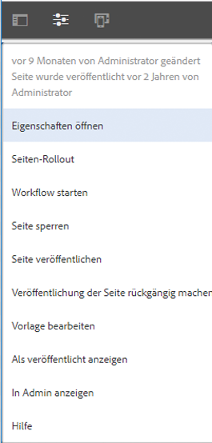

# Auswahl der Benutzeroberfläche{#selecting-your-ui}

Die Touch-optimierte Benutzeroberfläche von Adobe Experience Manager (AEM) ist jetzt die Standardbenutzeroberfläche, und die Funktionsparität bei der Administration und Bearbeitung von Sites wurde nahezu erreicht. Es kann jedoch vorkommen, dass Benutzende zur [klassischen Benutzeroberfläche](/help/sites-classic-ui-authoring/classicui.md) wechseln möchten. Dazu gibt es mehrere Möglichkeiten.

>[!NOTE]
>
>Weitere Informationen zum Status der Funktionsparität mit der klassischen Benutzeroberfläche finden Sie im Dokument [Funktionsparität bei der Touch-optimierten Benutzeroberfläche](/help/release-notes/touch-ui-features-status.md).

Es gibt verschiedene Stellen, an denen Sie definieren können, welche Benutzeroberfläche verwendet werden soll:

* [Konfigurieren der Standard-Benutzeroberfläche für Ihre Instanz](#configuring-the-default-ui-for-your-instance)
Dadurch wird die Standard-Benutzeroberfläche so festgelegt, dass sie bei der Benutzeranmeldung angezeigt wird. Benutzende können diese Einstellung außer Kraft setzen und eine andere Benutzeroberfläche für das eigene Konto oder die aktuelle Sitzung auswählen.

* [Festlegen der Inhaltserstellung mit der klassischen Benutzeroberfläche für Ihr Konto](/help/sites-authoring/select-ui.md#setting-classic-ui-authoring-for-your-account)
Dadurch wird die Benutzeroberfläche bei der Bearbeitung von Seiten als Standard festgelegt. Der Benutzer kann dies jedoch außer Kraft setzen und eine andere Benutzeroberfläche für sein Konto oder die aktuelle Sitzung auswählen.

* [Wechseln zur klassischen Benutzeroberfläche für die aktuelle Sitzung](#switching-to-classic-ui-for-the-current-session)
Wechselt zur klassischen Benutzeroberfläche für die aktuelle Sitzung.

* Im Falle der [Seitenbearbeitung überschreibt das System bestimmte Aspekte in Bezug auf die Benutzeroberfläche](#ui-overrides-for-the-editor).

>[!CAUTION]
>
>Verschiedene Optionen zum Wechseln zur klassischen Benutzeroberfläche sind nicht sofort standardmäßig verfügbar, sondern müssen für Ihre Instanz konfiguriert werden.
>
>Weitere Informationen finden Sie unter [Aktivieren des Zugriffs auf die klassische Benutzeroberfläche](/help/sites-administering/enable-classic-ui.md).

>[!NOTE]
>
>Instanzen, bei denen ein Upgrade von einer früheren Version durchgeführt wurde, behalten die klassische Benutzeroberfläche für die Seitenbearbeitung bei.
>
>Nach dem Upgrade wechselt die Seitenbearbeitung nicht automatisch zur Touch-optimierten Benutzeroberfläche. Sie können dies aber mit der [OSGi-Konfiguration](/help/sites-deploying/configuring-osgi.md) des **WCM-Authoring-UI-Modusdienstes** (`AuthoringUIMode`-Dienst) konfigurieren. Weitere Informationen dazu finden Sie unter [Benutzeroberflächenüberschreibung für den Editor](#ui-overrides-for-the-editor).

## Konfigurieren der Standard-Benutzeroberfläche für Ihre Instanz {#configuring-the-default-ui-for-your-instance}

Systemadmins können die Benutzeroberfläche konfigurieren, die beim Start und bei der Anmeldung angezeigt wird, indem sie die [Stammzuordnung](/help/sites-deploying/osgi-configuration-settings.md#daycqrootmapping) verwenden.

Dies kann durch Benutzerstandardeinstellungen oder Sitzungseinstellungen überschrieben werden.

## Einrichten der Seitenerstellung in der klassischen Benutzeroberfläche für Ihr Konto {#setting-classic-ui-authoring-for-your-account}

Benutzende können auf ihre [Benutzereinstellungen](/help/sites-authoring/user-properties.md#userpreferences) zugreifen, um zu definieren, ob sie die klassische Benutzeroberfläche anstelle der Standardbenutzeroberfläche für die Seitenbearbeitung verwenden möchten.

Dies kann durch Sitzungseinstellungen überschrieben werden.

## Wechseln zur klassischen Benutzeroberfläche für die aktuelle Sitzung {#switching-to-classic-ui-for-the-current-session}

Bei Verwendung der Touch-optimierten Benutzeroberfläche möchten Desktop-Benutzende vielleicht zur klassischen Benutzeroberfläche (nur für Desktops) zurückzukehren. Es gibt mehrere Methoden, um für die aktuelle Sitzung zur klassischen Benutzeroberfläche zu wechseln:

* **Navigations-Links**

  >[!CAUTION]
  >
  >Diese Option zum Wechseln zur klassischen Benutzeroberfläche ist nicht sofort standardmäßig verfügbar, sondern muss für Ihre Instanz konfiguriert werden.
  >
  >
  >Weitere Informationen finden Sie unter [Aktivieren des Zugriffs auf die klassische Benutzeroberfläche](/help/sites-administering/enable-classic-ui.md).

  Wenn diese Option aktiviert ist, wird jedes Mal, wenn Sie den Mauszeiger über eine entsprechende Konsole bewegen, ein Symbol (ein Monitorsymbol) angezeigt. Wenn Sie darauf tippen/klicken, wird der entsprechende Bereich in der klassischen Benutzeroberfläche geöffnet.

  Zum Beispiel die Verknüpfungen von **Sites** zu **siteadmin**:

  

* **URL**

  Die klassische Benutzeroberfläche kann über die URL für den Begrüßungsbildschirm unter `welcome.html` aufgerufen werden. Beispiel:

  `https://localhost:4502/welcome.html`

  >[!NOTE]
  >
  >Die Touch-optimierte Benutzeroberfläche kann über `sites.html` aufgerufen werden. Beispiel:
  >
  >
  >`https://localhost:4502/sites.html`

### Wechseln zur klassischen Benutzeroberfläche bei der Bearbeitung einer Seite {#switching-to-classic-ui-when-editing-a-page}

>[!CAUTION]
>
>Diese Option zum Wechseln zur klassischen Benutzeroberfläche ist nicht sofort standardmäßig verfügbar, sondern muss für Ihre Instanz konfiguriert werden.
>
>Weitere Informationen finden Sie unter [Aktivieren des Zugriffs auf die klassische Benutzeroberfläche](/help/sites-administering/enable-classic-ui.md).

Sofern aktiviert, ist die Option **Klassische Benutzeroberfläche öffnen** im Dialogfeld **Seiteninformationen** verfügbar:

### Benutzeroberflächenüberschreibungen für den Editor {#ui-overrides-for-the-editor}

Die von Benutzenden oder Systemadmins festgelegten Einstellungen können bei der Seitenbearbeitung vom System außer Kraft gesetzt werden.

* Beim Bearbeiten von Seiten:

  * Die Verwendung des klassischen Editors wird erzwungen, wenn die Seite über eine URL aufgerufen wird, die `cf#` enthält. Beispiel:
    `https://localhost:4502/cf#/content/geometrixx/en/products/triangle.html`

  * Die Verwendung des Touch-optimierten Editors wird erzwungen, wenn `/editor.html` in der URL verwendet oder ein Touch-Gerät genutzt wird. Beispiel:
    `https://localhost:4502/editor.html/content/geometrixx/en/products/triangle.html`

* Jede erzwungene Einstellung ist temporär und nur für die aktuelle Browser-Sitzung gültig.

  * Ein Cookie wird abhängig davon gesetzt, ob die Touch-optimierte (`editor.html`) oder die klassische (`cf#`) Variante verwendet wird.

* Beim Öffnen von Seiten durch `siteadmin` wird überprüft, ob Folgendes vorhanden ist:

  * dem Cookie
  * einer Benutzervoreinstellung
  * Wenn keines von beiden vorhanden ist, werden standardmäßig die Definitionen verwendet, die in der [OSGi-Konfiguration](/help/sites-deploying/configuring-osgi.md) des **WCM Authoring UI Mode Service** (`AuthoringUIMode`-Service) festgelegt sind.

>[!NOTE]
>
>Wenn [eine Benutzerin oder ein Benutzer bereits eine Voreinstellung für die Seitenbearbeitung definiert hat](#settingthedefaultauthoringuiforyouraccount), wird diese nicht durch Ändern der OSGi-Eigenschaft überschrieben.

>[!CAUTION]
>
>Aufgrund der Verwendung von Cookies wird, wie bereits beschrieben, Folgendes nicht empfohlen:
>
>* Manuelles Bearbeiten der URL – Eine nicht-standardmäßige URL könnte zu einer unbekannten Situation und fehlender Funktionalität führen.
>* Verwenden Sie beide Editoren zur selben Zeit, z. B. in separaten Fenstern.
