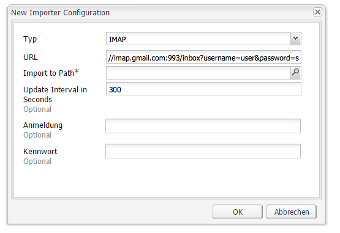
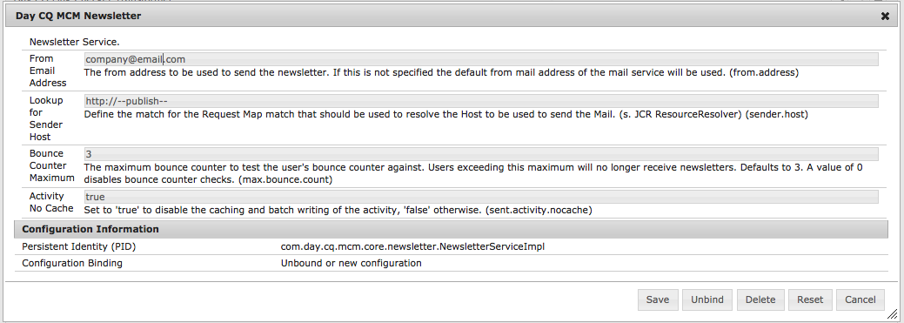

# Nachverfolgen nicht zugestellter E-Mails{#tracking-bounced-emails}

>[!NOTE]
>
>Adobe plant nicht, die Verfolgung von über den AEM-SMTP-Dienst gesendeten offenen/zurückgesendeten E-Mails weiter auszubauen.
>
>Es wird empfohlen, [Adobe Campaign und dessen AEM-Integration](/help/sites-administering/campaign.md) zu verwenden.

Wenn Sie einen Newsletter an viele Benutzer senden, sind in der Liste im Allgemeinen einige ungültige E-Mail-Adressen enthalten. Newsletter, die an diese Adressen gesendet werden, können nicht zugestellt werden. AEM kann diese nicht zugestellten E-Mails verwalten und den Versand von Newslettern an diese Adressen stoppen, wenn die festgelegte Anzahl erfolgloser Zustellversuche überschritten wird. Der Standardwert für fehlgeschlagene Zustellversuche beträgt 3, er kann jedoch angepasst werden.

Um AEM so einzurichten, dass es nicht zugestellte E-Mails nachverfolgt, richten Sie AEM so ein, dass es ein vorhandenes Postfach abfragt, in dem nicht zugestellte E-Mails empfangen werden. In der Regel ist dies die E-Mail-Adresse „von“, die Sie für den Versand des Newsletters als Absender angeben. AEM fragt diesen Posteingang ab und importiert alle E-Mails in das in den Abrufeinstellungen festgelegte Verzeichnis. Dann wird ein Workflow gestartet, bei dem in den Benutzern nach den E-Mail-Adressen gesucht wird, an die keine Zustellung erfolgen konnte, und der Eigenschaftswert „bounceCounter“ des Benutzers entsprechend aktualisiert wird. Nach Überschreiten der festgelegten Maximalanzahl an fehlgeschlagenen Zustellversuchen wird die Benutzerin bzw. der Benutzer aus der Newsletter-Liste entfernt.

## Konfigurieren des Feed-Importtools {#configuring-the-feed-importer}

Mit dem Feed Importer können Sie wiederholt Inhalte aus externen Quellen in Ihr Repository importieren. Mit dieser Konfiguration des Feed-Importtools überprüft AEM das Absenderpostfach auf nicht zugestellte E-Mails.

Gehen Sie wie folgt vor, um das Feed-Importtool zum Nachverfolgen nicht zugestellter E-Mails zu konfigurieren:

1. Wählen Sie unter **Tools** die Option „Feed-Importtool“.

1. Klicken Sie auf **Hinzufügen**, um eine Konfiguration zu erstellen.

   

1. Fügen Sie eine neue Konfiguration hinzu, indem Sie den Typ wählen und Informationen zur Abruf-URL angeben, um so den Host und den Port zu konfigurieren. Fügen Sie außerdem einige Mail- und protokollspezifische Parameter zur URL-Abfrage hinzu. Stellen Sie die Konfiguration so ein, dass mindestens einmal täglich eine Abfrage durchgeführt wird.

   Alle Konfigurationen benötigen Informationen über Folgendes in der Abruf-URL:

   `username`: Der Benutzername, der zum Verbinden verwendet wird

   `password`: Das Passwort für die Verbindung

   Darüber hinaus können Sie je nach Protokoll bestimmte Einstellungen konfigurieren.

   **Eigenschaften der POP3-Konfiguration:**

   `pop3.leave.on.server`: Legt fest, ob Nachrichten auf dem Server bleiben. Wählen Sie „true“, wenn Nachrichten auf dem Server bleiben sollen, bzw. „false“, wenn dies nicht der Fall sein soll. Standardwert ist „true“.

   **POP3-Beispiele:**

   | pop3s://pop.gmail.com:995/INBOX?username=user&amp;password=secret | Verwenden von pop3 über SSL zur Verbindung mit GMail an Port „995“ mit „user/secret“, sodass Nachrichten standardmäßig auf dem Server bleiben |
   |---|---|
   | pop3s://pop.gmail.com:995/INBOX?username=user&amp;password=secret&amp;pop3.leave.on.server=false | pop3s://pop.gmail.com:995/INBOX?username=user&amp;password=secret&amp;pop3.leave.on.server=false |

   **Eigenschaften der IMAP-Konfiguration:**

   Hier können Sie Markierungen festlegen, nach denen gesucht werden soll.

   `imap.flag.SEEN`:Set „false“ für neue/nicht gelesene Nachrichten, „true“ für bereits gelesene Nachrichten

   Siehe [https://javaee.github.io/javamail/docs/api/index.html?javax/mail/Flags.Flag.html](https://javaee.github.io/javamail/docs/api/index.html?javax/mail/Flags.Flag.html) für die vollständige Liste der Markierungen.

   **IMAP-Beispiele:**

   | imaps://imap.gmail.com:993/inbox?username=user&amp;password=secret | Verwendung von IMAP über SSL, um an Port 993 eine Verbindung zu GMail mit dem Konto user/secret herzustellen. Standardmäßig werden nur neue Nachrichten abgerufen. |
   |---|---|
   | imaps://imap.gmail.com:993/inbox?username=user&amp;password=secret&amp;imap.flag.SEEN=true | Verwendung von IMAP über SSL zur Verbindung durch GMail-Port 993 mit „user/secret“, um nur bereits gesehene Nachrichten abzurufen. |
   | imaps://imap.gmail.com:993/inbox?username=user&amp;password=secret&amp;imap.flag.SEEN=true&amp;imap.flag.SEEN=false | Verwendung von IMAP über SSL zur Verbindung durch GMail-Port 993 mit „user/secret“, um bereits gesehene ODER neue Nachrichten abzurufen. |

1. Speichern Sie die Konfiguration.

## Konfigurieren der Newsletter-Dienstkomponente {#configuring-the-newsletter-service-component}

Konfigurieren Sie nach der Konfiguration des Feed-Importtools die Absenderadresse und den Zähler für nicht erfolgreiche Zustellversuche.

So konfigurieren Sie den Newsletter-Dienst:

1. Navigieren Sie in der OSGi-Konsole unter `<host>:<port>/system/console/configMgr` zu **MCM-Newsletter**.

1. Konfigurieren Sie den Dienst und speichern Sie anschließend die Änderungen.

   

   Die folgenden Konfigurationen können festgelegt werden, um das Verhalten anzupassen:

   | Maximalwert des Zählers für erfolglose Zustellversuche (max.bounce.count) | Bestimmt, nach wie vielen erfolglosen Zustellversuchen eine Benutzerin oder ein Benutzer beim Versand eines Newsletters ausgelassen wird. Wenn Sie diesen Wert auf 0 setzen, wird die Überprüfung auf erfolglose Zustellversuche vollständig deaktiviert. |
   |---|---|
   | Kein-Cache-Aktivität (sent.activity.nocache) | Definiert die Cache-Einstellung, die für die Aktivität „Newsletter gesendet“ verwendet werden soll |

   Nach dem Speichern führt der MCM-Dienst für den Newsletter Folgendes durch:

   * Schreibt eine Aktivität in den verborgenen Stream der Benutzenden nach erfolgreichem Versand eines Newsletters.
   * Schreibt eine Aktivität, wenn ein fehlgeschlagener Zustellversuch ermittelt wird und die Anzahl der nicht zugestellten Nachrichten für Benutzende sich ändert.
