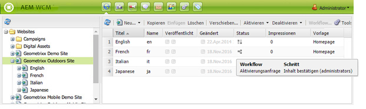
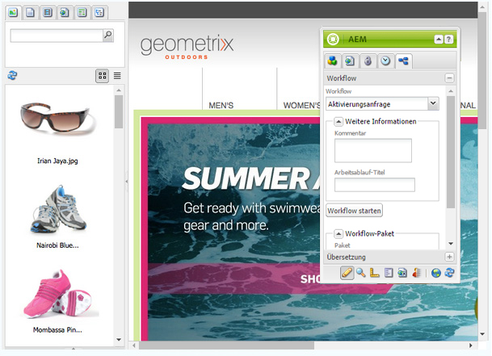

# Anwenden von Workflows auf Seiten{#applying-workflows-to-pages}

Wenn Sie den Workflow anwenden, geben Sie die folgenden Informationen an:

* Der anzuwendende Workflow.

  Sie können jeden beliebigen Workflow anwenden (auf den Sie Zugriff haben, wie von Ihrem AEM-Administrator zugewiesen).
* Optional:

  * Ein Kommentar, der Auskunft darüber gibt, warum Sie den Workflow gestartet haben.
  * Ein Titel, der dabei hilft, die Workflow-Instanz im Posteingang eines Benutzers zu identifizieren.

>[!NOTE]
>
>AEM-Admins können Workflows unter Verwendung von [mehreren anderen Methoden](/help/sites-administering/workflows-starting.md) starten.

## Anwenden von Workflows {#applying-workflows}

Workflows können entweder über die Websites-Konsole oder beim Bearbeiten einer Seite über den Sidekick gestartet werden.

Die Spalte **Status** in der **Websites**-Konsole gibt an, ob ein Workflow auf eine Seite angewendet wurde:

### Starten eines Workflows aus der Websites-Konsole {#starting-a-workflow-from-the-websites-console}

1. Öffnen Sie die Websites-Konsole. ([http://localhost:4502/siteadmin](http://localhost:4502/siteadmin))
1. Wählen Sie in der Website-Struktur das übergeordnete Element der Seite aus, auf die Sie den Workflow anwenden möchten.
1. Wählen Sie in der Seitenliste die Seite aus und klicken Sie dann auf „Workflow“.
1. Wählen Sie im Dialogfeld „Workflow starten“ den Workflow aus, der angewendet werden soll. Geben Sie optional einen Kommentar und einen Titel ein. Klicken Sie dann auf „Starten“.

### Starten eines Workflows über den Sidekick {#starting-a-workflow-using-sidekick}

1. Öffnen Sie die Websites-Konsole.
1. Öffnen Sie die gewünschte Seite.
1. Wählen Sie im Sidekick die Registerkarte „Workflow“ aus.
1. Erweitern Sie das Dialogfeld **Workflow**, um den **Workflow** auszuwählen, und geben Sie optional einen **Workflow-Titel** und einen **Kommentar** ein.

   

1. Klicken Sie auf **Workflow starten**, um eine neue Workflow-Instanz mit den Eigenschaften zu starten, die Sie konfiguriert haben, und mit der aktuellen Seite als Payload. Jetzt wird der Workflow ausgeführt.
