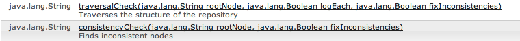

# Konsistenz- und Durchlaufprüfungen{#consistency-and-traversal-checks}

Beim Aktualisieren können aufgrund von Arbeitsbereichsinkonsistenzen Probleme auftreten. Sie können eine Testaktualisierung ausführen, um anzuzeigen, ob dies ein Problem darstellt, oder Konsistenzüberprüfungen als Präventivmaßnahme ausführen.

Wenn Sie eine Testaktualisierung ausführen, die aufgrund von Arbeitsbereichsinkonsistenzen fehlschlägt, werden in der Datei „crx-quickstart/logs/crx/error.log“ Einträge angezeigt, die den folgenden ähneln:

```xml
*ERROR* TarPersistenceManager: No bundle found for uuid 'deadbeef-cafe-babe-cafe-babecafebabe'
 ...
*ERROR* RepositoryImpl: Failed to initialize workspace 'crx.default'
javax.jcr.RepositoryException: Error indexing workspace: Error indexing workspace: Error indexing workspace
...
```

## Ausführen einer Konsistenzüberprüfung {#perform-a-consistency-check}

Navigieren Sie zum Ausführen einer Konsistenzüberprüfung zur Verwaltungsseite für das JMX MBean **com.adobe.granite (Repository)**. Wechseln Sie auf dem AEM-Hauptbildschirm zu:

**Tools > Web-Konsole > Haupt (auf der Menüleiste) > JMX > com.adobe.granite (Repository)**

In einer Standardinstallation befindet er sich hier: **[|Anzeigen|](http://localhost:4502/system/console/jmx/com.adobe.granite%3Atype%3DRepository)**

Im Abschnitt **Vorgänge** der Seite finden Sie zwei Methoden: **`traversalCheck`** und **`consistencyCheck`**. Klicken Sie zum Ausführen einer Überprüfung auf den Vorgang und geben Sie die gewünschten Parameter ein.


