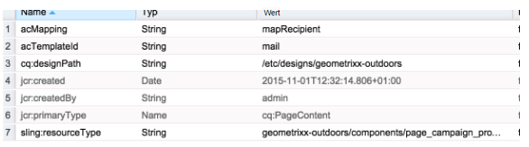

# Erstellen benutzerdefinierter AEM-Seitenvorlagen mit Adobe Campaign-Formularkomponenten{#creating-custom-aem-page-template-with-adobe-campaign-form-components}

Auf dieser Seite wird anhand der Implementierung der Geometrixx Outdoors-Vorlage (`/apps/geometrixx-outdoors/components/page_campaign_profile`) erläutert, wie Sie eine benutzerdefinierte Seitenvorlage auf Basis von [Adobe Campaign-Formularkomponenten](/help/sites-authoring/adobe-campaign-components.md) erstellen. Darüber hinaus erhalten Sie wichtige Informationen, die Sie möglicherweise beim Erstellen Ihrer eigenen benutzerdefinierten Vorlage benötigen.

>[!CAUTION]
>
>Die E-Mail-Komponenten von AEM werden nicht mehr unterstützt. Aufgrund der Art von E-Mails, bei denen Inhalt und Stil zusammengeführt werden, können die standardmäßig von AEM bereitgestellten E-Mail-Komponenten von Kunden nur eingeschränkt wiederverwendet werden, da benutzerdefinierte Stile in allen Komponenten implementiert werden müssen, die für Projekte erforderlich sind.
>
>E-Mail-Komponenten können auf Projektebene implementiert werden. Die veralteten AEM-E-Mail-Komponenten veranschaulichen, wie dies erreicht werden kann. Verwenden Sie diese veralteten Komponenten jedoch nicht in Projekten.


Um eine benutzerdefinierte AEM-Seitenvorlage mit Adobe Campaign-Formularkomponenten zu erstellen, müssen Sie über Folgendes verfügen:

1. **Die richtige resourceSuperType-Klasse**

   Stellen Sie sicher, dass die Seitenkomponente von `mcm/campaign/components/profile` erbt.

   Dies ist erforderlich, damit die Servlets Informationen empfangen und speichern können.

   * `com.day.cq.mcm.campaign.servlets.TemplateListServlet`
   * `com.day.cq.mcm.campaign.servlets.SaveProfileServlet`

   

1. **ClientContext-Einstellungen**

   In den ClientContext-Einstellungen (`/etc/designs/geometrixx-outdoors/jcr:content/page_campaign_profile`) sehen Sie die folgenden Einstellungen:

   * ClientContext verweist auf `/etc/clientcontext/campaign`.
   * Es ist außerdem ein zusätzlicher Knoten *config* vorhanden.

   

1. **head.jsp (/apps/geometrixx-outdoors/components/page_campaign_profile/head.jsp)**

   **head.jsp** enthält die folgenden Zeilen, die **clientcontext-config** und **cloudservice-hook** verwenden:

   ```
   <cq:include path="config" resourceType="cq/personalization/components/clientcontext_optimized/config"/>
   <sling:include path="contexthub" resourceType="granite/contexthub/components/contexthub"/>
   <cq:include script="/libs/cq/cloudserviceconfigs/components/servicelibs/servicelibs.jsp"/>
   ```

1. **body.jsp (/apps/geometrixx-outdoors/components/page_campaign_profile/body.jsp)**

   In **body.jsp** werden die Cloud-Services unten auf der Seite geladen:

   ```
   <cq:include path="cloudservices" resourceType="cq/cloudserviceconfigs/components/servicecomponents"/>
   ```

1. **Eigenschaften von Campaign-Seiten**

   Um eine Adobe Campaign-Vorlage auswählen zu können, müssen die Seiteneigenschaften um die Registerkarte **Campaign** erweitert werden:

   `/apps/geometrixx-outdoors/components/page_campaign_profile/dialog/items/tabs/items/campaign`

   

1. **Vorlageneinstellungen**.

   In der Vorlage (`/apps/geometrixx-outdoors/templates/campaign_profile/jcr:content` ) sind die folgenden Standardwerte enthalten:

   | **acMapping** | mapRecipient (für Adobe Campaign 6.1), profile (für Adobe Campaign Standard) |
   |---|---|
   | **acTemplateId** | Mail |

   
