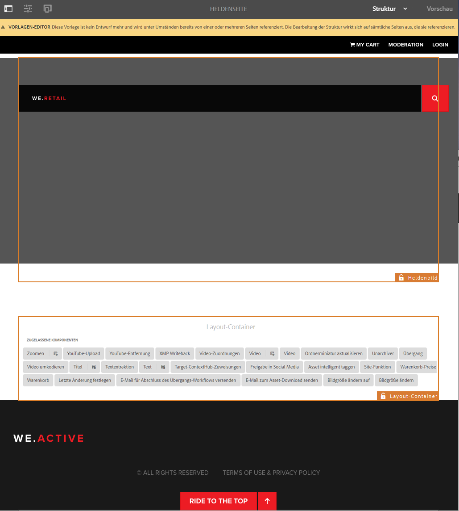
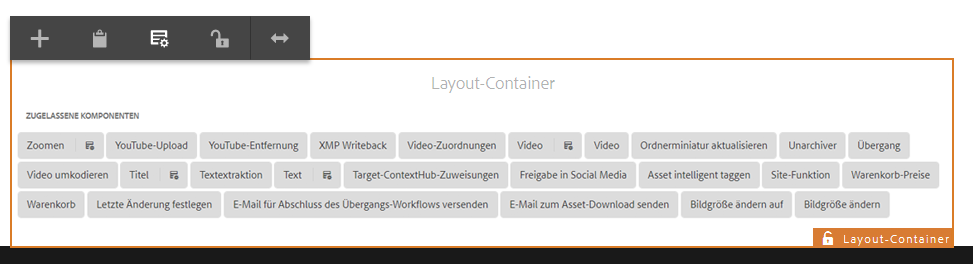
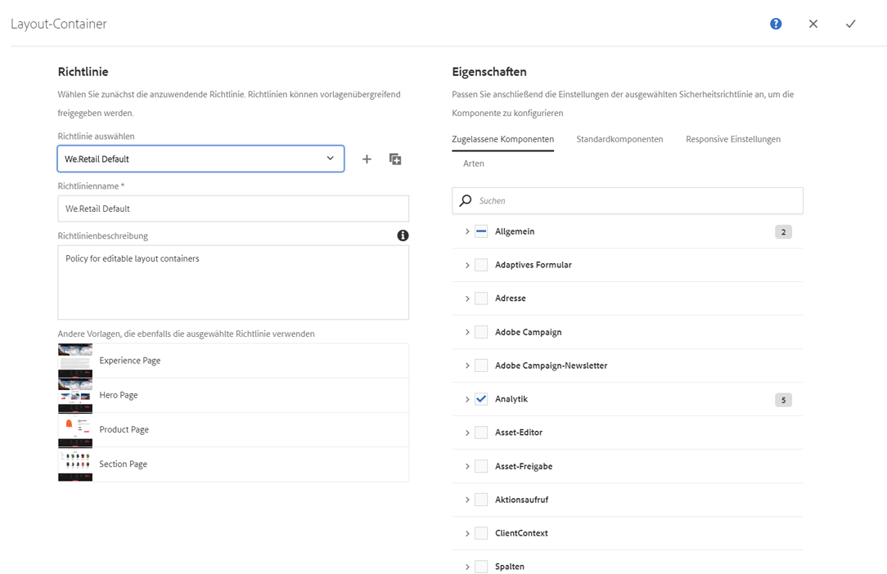
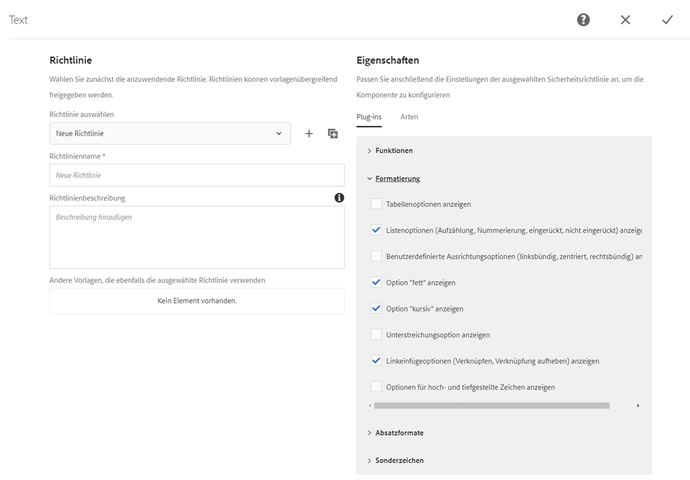

# Testen bearbeitbarer Vorlagen in We.Retail{#trying-out-editable-templates-in-we-retail}

Dank der bearbeitbaren Vorlagen ist das Erstellen und Verwalten von Vorlagen nicht mehr nur eine Aufgabe für Entwickelnde. Ein erfahrener Benutzer, ein so genannter Vorlagenautor, kann nun Vorlagen erstellen. Entwickler müssen weiterhin die Umgebung einrichten, Clientbibliotheken erstellen und die zu verwendenden Komponenten erstellen. Sobald diese Grundlagen vorhanden sind, hat der Vorlagenautor jedoch die Flexibilität, Vorlagen ohne Entwicklungsprojekt zu erstellen und zu konfigurieren.

Alle Seiten in We.Retail basieren auf bearbeitbaren Vorlagen, sodass auch Menschen ohne Entwicklungserfahrung die Vorlagen anpassen und personalisieren können.

## Probieren Sie es aus {#trying-it-out}

1. Bearbeiten Sie die Seite „Ausrüstung“ der Sprach-Primär-Verzweigung.

   http://localhost:4502/editor.html/content/we-retail/language-masters/en/equipment.html

1. Die Modusauswahl bietet keinen Design-Modus mehr. Alle Seiten für We.Retail basieren auf bearbeitbaren Vorlagen. Um das Design von bearbeitbaren Vorlagen zu ändern, müssen sie im Vorlageneditor bearbeitet werden.
1. Wählen Sie aus dem Menü **Seiteninformationen** die Option **Vorlage bearbeiten** aus.
1. Sie bearbeiten jetzt die Hero-Seitenvorlage.

   Im Strukturmodus der Seite können Sie die Struktur der Vorlage ändern. Dazu gehören beispielsweise die Komponenten, die im Layout-Container zulässig sind.

   

1. Konfigurieren Sie die Richtlinien für den Layout-Container, um festzulegen, welche Komponenten im Container zulässig sind.

   Richtlinien entsprechen Design-Konfigurationen.

   

1. Im Dialogfeld „Design“ des Layout-Containers können Sie

   * eine vorhandene Richtlinie auswählen oder eine Richtlinie für den Container erstellen
   * auswählen, welche Komponenten im Container zulässig sind
   * die Standardkomponenten festlegen, die platziert werden sollen, wenn ein Asset in den Container gezogen wird

   

1. Im Vorlageneditor können Sie die Richtlinie für die Textkomponente im Layout-Container bearbeiten.

   Damit können Sie:

   * eine vorhandene Richtlinie auswählen oder eine Richtlinie für den Container erstellen
   * festlegen, welche Funktionen den Seitenautorinnen und -autoren bei Verwendung dieser Komponente zur Verfügung stehen, z. B.

     * zulässige Einfügequellen
     * Formatierungsoptionen
     * zulässige Absatzstile
     * zulässige Sonderzeichen

   Viele Komponenten, die auf den Kernkomponenten basieren, ermöglichen die Konfiguration von Optionen auf Komponentenebene über die bearbeitbaren Vorlagen, sodass Entwickelnde keine Anpassungen mehr vornehmen müssen.

   

1. Im Vorlageneditor können Sie mit der Modusauswahl zum Modus **Anfänglicher Inhalt** wechseln, um festzulegen, welcher Inhalt auf der Seite erforderlich ist.

   Der **Layout**-Modus kann auf einer normalen Seite unverändert verwendet werden, um das Layout für die Vorlage zu definieren.

## Weitere Informationen {#more-information}

Umfassende technische Informationen zu bearbeitbaren Vorlagen finden Sie im Dokument [Erstellen von Seitenvorlagen](/help/sites-authoring/templates.md) für Autorinnen und Autoren oder im Dokument [Bearbeitbare Seitenvorlagen](/help/sites-developing/page-templates-editable.md) für Entwickelnde.

Sie können sich darüber hinaus eingehender mit [Kernkomponenten](/help/sites-developing/we-retail-core-components.md) befassen. Im Dokument [Kernkomponenten](https://experienceleague.adobe.com/docs/experience-manager-core-components/using/introduction.html?lang=de) für Autoren finden Sie einen Überblick über die Kernkomponenten. Im Dokument [Dokumentation zur Entwicklung der Kernkomponenten](https://helpx.adobe.com/de/experience-manager/core-components/using/developing.html) für Entwickler finden Sie einen technischen Überblick.
